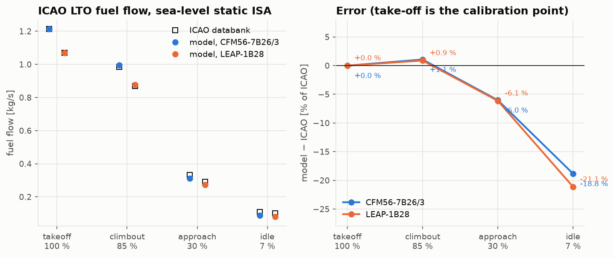
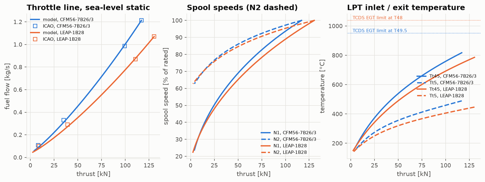

# Propulsion From Scratch

[](https://github.com/GMCavalheri/propulsion-from-scratch/actions/workflows/ci.yml)

Gas turbine engine performance modelled from first principles in Python and NumPy:
- the International Standard Atmosphere and one-dimensional gas dynamics;
- the ideal Brayton cycle and turbojet;
- real component losses, with polytropic efficiencies and two gas models;
- a two-spool, separate-exhaust turbofan;
- off-design performance of a fixed-geometry engine (matching, corrected parameters, N1/N2,
  EGT, fuel flow);
- parametric trade studies on bypass ratio, pressure ratio and turbine temperature.

No engine-performance or thermodynamics libraries are used. Every module is verified against
exact identities and closed forms. The off-design model is validated against published ICAO
and EASA data for the **CFM56-7B** (Boeing 737NG) and the **LEAP-1B** (737 MAX).

**New to the subject? Start with the [seven-lesson course](docs/lessons/README.md).**

<p align="center">
  
  
  
</p>

## What's inside

| Module | Method | Verified / validated against |
|---|---|---|
| [`atmosphere`](src/propulsion/atmosphere), [`gas`](src/propulsion/gas) | ISA from hydrostatics, perfect-gas isentropic flow, mass-flow parameter | US Standard Atmosphere 1976 tables (every printed digit), Anderson's tables |
| [`brayton_cycle`](src/propulsion/brayton_cycle) | closed Brayton cycle, ideal turbojet (Mattingly's τ notation) | closed-form identities, brute-force optimum πc |
| [`component_models`](src/propulsion/component_models) | inlet recovery, polytropic turbomachinery, burner with heating-value datum, ideal/convergent nozzles, non-ideal turbojet | exact ideal limit, stage stacking, entropy, energy balances |
| [`turbofan_model`](src/propulsion/turbofan_model) | two-spool separate-exhaust turbofan, core and bypass thrust | α = 0 turbojet limit, ideal optima α* and πf* |
| [`off_design_performance`](src/propulsion/off_design_performance) | fixed-geometry matching (choked turbines, nozzle areas), continuation solver, worn components | design-point reproduction, corrected similarity, **ICAO LTO fuel flows of the CFM56-7B26/3 and LEAP-1B28** |
| [`trade_studies`](src/propulsion/trade_studies) | best-fan sweeps, carpet plots, fan-diameter and Lighthill jet-noise proxies | ideal closed forms, TCDS weights, ICAO NOx trend |

## Headline results

| Benchmark | Result |
|---|---|
| ISA vs US 1976 tables | matches every printed digit |
| Ideal-cycle identities, exact limits, closed-form optima | round-off (≤ 1e-15) or grid resolution |
| Off-design similarity (3 km vs 9 km, same corrected point) | 2e-15 |
| CFM56-7B26/3, ICAO fuel flow at 85 / 30 / 7 % thrust (one calibration at 100 %) | +1.1 / −6.0 / −18.8 % |
| LEAP-1B28, same | +0.9 / −6.1 / −21.1 % |
| CFM56-7B → LEAP-1B cruise TSFC, cycle only | −11.0 % (OPR −2.7, Tt4 −1.1, fan −7.5) |
| ICAO take-off NOx vs model compressor-exit temperature | 21.8 → 72.7 g/kg as Tt3 rises 808 → 920 K |

The full comparison, figures and discussion of every discrepancy are in the
**[validation report](docs/validation-report.md)**, including six bugs that validation caught.

## Quickstart

Requires [uv](https://docs.astral.sh/uv/).

```bash
uv sync
uv run pytest
```

```python
from propulsion.component_models import Components
from propulsion.flight import FlightCondition
from propulsion.off_design_performance import TurbofanEngine
from propulsion.turbofan_model import turbofan
from propulsion.units import FT

fl350 = FlightCondition.at_altitude(35000 * FT, 0.78, geopotential=True)  # flight level

# Cycle design: a 5.5-bypass turbofan at cruise
p = turbofan(
    fl350, alpha=5.5, pi_f=1.7, pi_c=32.0, Tt4=1450.0, pi_cL=1.6, components=Components.modern()
)
print(f"{p.specific_thrust:.1f} N s/kg, TSFC {p.tsfc * 1e6:.2f} mg/(N s)")  # 193.8, 18.99

# Off-design: size an engine at sea-level static, then fly it
engine = TurbofanEngine.design(
    FlightCondition.sea_level_static(),
    alpha=5.1,
    pi_f=1.8,
    pi_c=27.7,
    Tt4=1420.0,
    pi_cL=1.6,
    thrust=117e3,
)
cruise = engine.operate_at_thrust(fl350, 22e3)
print(
    f"cruise: Tt4 {cruise.Tt4:.0f} K, N1 {100 * cruise.N1:.1f} %, "
    f"N2 {100 * cruise.N2:.1f} %, fuel {cruise.fuel_flow * 3600:.0f} kg/h"
)
```

Calibrated models of the real engines are in [`validation/engines.py`](validation/engines.py):

```bash
uv run python validation/run_all.py           # every validation figure and table (~15 s)
uv run python notebooks/build_notebooks.py    # executed demo notebooks
```

## Documentation

- **[The course](docs/lessons/README.md)**: seven lessons with derivations, worked examples and
  exercises with answers.
- Theory notes: [atmosphere & gas](docs/atmosphere_and_gas.md) ·
  [Brayton cycle](docs/brayton_cycle.md) · [components](docs/component_models.md) ·
  [turbofan](docs/turbofan_model.md) · [off-design](docs/off_design_performance.md) ·
  [trade studies](docs/trade_studies.md).
- **[From model parameters to EGT, N1, N2 and fuel flow](docs/flight-parameters.md)**: how
  the cycle shows up in engine monitoring data, with degradation signatures for fan, compressor
  and turbine wear.
- [Validation report](docs/validation-report.md) · [notebooks](notebooks/).

## Data

Public sources only, each value cited in [`validation/reference_data/`](validation/reference_data):
- the ICAO Aircraft Engine Emissions Databank (Issue 32, hosted by EASA);
- EASA type-certificate data sheets E.004 (CFM56-7B, Issue 07) and E.115 (LEAP-1B, Issue 09).

Component efficiencies, gas properties and the booster pressure ratio are **assumptions**, and
are labelled as such wherever they are used. Validation is trend-level: real engine maps are
proprietary.

## Repository layout

```
src/propulsion/      atmosphere, gas, brayton_cycle, component_models, turbofan_model,
                     off_design_performance, trade_studies, flight.py, units.py, plotting.py
tests/               pytest, one file per module (+ a check that docs math renders on GitHub)
validation/          cited reference data, calibrated engine models, validation scripts, results
docs/                theory notes, validation report, figures, lessons/ (the course)
notebooks/           executed demos, generated by build_notebooks.py
```

Part of a five-project series on the classical pillars of aerospace engineering, after
[aerodynamics](https://github.com/GMCavalheri/aerodynamics-from-scratch) and
[aircraft structures](https://github.com/GMCavalheri/aircraft-structures-from-scratch).

## License

MIT
