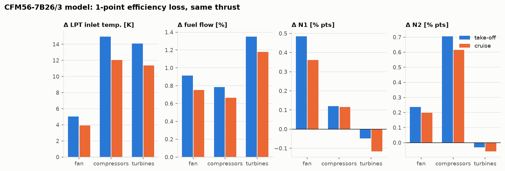

# From model parameters to flight data: EGT, N1, N2 and fuel flow

Engine health monitoring, reliability analysis and remaining-useful-life (RUL) models work with
the few quantities an engine actually reports: EGT, N1, N2, fuel flow, and the flight condition.
This note connects each of them to the stations and parameters of this model. The point is that
those signals stop being anonymous ML features: each one is a consequence of the cycle.

Code: [`validation/degradation_signatures.py`](../validation/degradation_signatures.py) ·
Lessons: [5](lessons/05-off-design.md), [7](lessons/07-verification-and-validation.md)

## 1. What is measured, and where it sits in the cycle

| Flight-data quantity | Physical meaning | Model quantity |
|---|---|---|
| **N1** | LP spool speed (fan, booster, LPT) | `OperatingPoint.N1`: $\sqrt{\Delta h_{fan}/\Delta h_{fan,design}}$ |
| **N2** | HP spool speed (HPC, HPT) | `OperatingPoint.N2`: $\sqrt{\Delta h_{HPC}/\Delta h_{HPC,design}}$ |
| **EGT** | gas temperature in the turbine section | between `Tt45` (LPT inlet) and `Tt5` (LPT exit) |
| **Fuel flow** $W_f$ | fuel mass flow | `OperatingPoint.fuel_flow` $= f\dot m_{core}$ |
| TAT, SAT | total and static air temperature | $T_{t0}$, $T_0$ |
| pressure altitude, Mach | flight condition | `FlightCondition.at_altitude(h, M0, geopotential=True)` |

Where EGT is measured is set by the type certificate. The CFM56-7B measures at **T49.5**, the
second-stage LP turbine nozzle (EASA TCDS E.004, Issue 07). The LEAP-1B measures at **T48**, the LP
turbine inlet (TCDS E.115, Issue 09). In this model, the LEAP's EGT corresponds to $T_{t45}$ and the
CFM56's lies between $T_{t45}$ and $T_{t5}$. The model has no cooling flows and its turbine
temperature is calibrated (Lesson 5), so use model EGT for *changes* and *trends*, not absolute
values.

The NASA C-MAPSS turbofan degradation datasets used in many RUL studies (Saxena et al., "Damage
propagation modeling for aircraft engine run-to-failure simulation", PHM 2008) report the same
kind of signals. Among them are T24, T30 and T50 (LPC, HPC and LPT exit temperatures), P30 (HPC
exit pressure), Nf and Nc (fan and core speeds) and the bypass ratio. In this model's station
numbering these are $T_{t25}$, $T_{t3}$, $T_{t5}$, $P_{t3}$, N1, N2 and α.

## 2. Why the same engine reads differently every flight: corrections

From Lesson 5, an engine at the same flight Mach number and corrected throttle $T_{t4}/\theta_0$
is in the same non-dimensional state at any altitude and temperature. Monitoring programs
therefore compare readings in corrected form:

```math
N_{1c} = \frac{N_1}{\sqrt{\theta_2}}, \qquad
\dot m_c = \frac{\dot m\sqrt{\theta_2}}{\delta_2}, \qquad
W_{fc} = \frac{W_f}{\delta_2\sqrt{\theta_2}}, \qquad
T_c = \frac{T}{\theta_2}, \qquad
\theta_2 = \frac{T_{t2}}{288.15\ \mathrm{K}}, \quad \delta_2 = \frac{P_{t2}}{101.325\ \mathrm{kPa}}
```

In practice correction exponents are tuned per engine type, because the fuel's heating value
breaks exact similarity (`test_corrected_parameters_are_similar` shows the similarity is exact
only with the fuel mass neglected). Two consequences visible in the model:

- **Hot days eat EGT margin.** Holding rated take-off thrust at ISA+15 needs about 73 K more
  $T_{t4}$ in the CFM56 model, and raises $T_{t45}$ by 56 K
  ([engine validation](../validation/results/engine_validation.md)). That is why engines are
  flat-rated and why EGT margin is tracked against outside air temperature.
- **Cruise is near take-off in corrected terms.** At FL350 the CFM56 model runs at 100.5 %
  corrected N1 while its physical N1 is 92.8 % (Lesson 5).

## 3. How each model parameter shows up

| Model parameter | What changing it does to the observables |
|---|---|
| $T_{t4}$ (the throttle) | Thrust, $W_f$, N1, N2 and EGT all rise together along the operating line; the bypass ratio falls. This is the line that health monitoring compares against. |
| fan polytropic efficiency $e_f$ | The fan needs more work for the same pressure ratio: **N1 rises**, $W_f$ rises, EGT rises a little. |
| compressor efficiency $e_c$ (booster + HPC) | Hotter compressor exit at the same pressure: **N2 rises**, and **EGT rises the most**. |
| turbine efficiency $e_t$ (HPT + LPT) | Each spool needs a hotter, richer gas for the same work: **$W_f$ rises the most**, EGT rises, speeds barely move. |
| burner pressure loss $\pi_b$, combustion efficiency $\eta_b$ | More fuel for the same $T_{t4}$, or lower $P_{t4}$: $W_f$ and EGT rise. |
| nozzle and turbine throat areas ($A_9$, $A_{19}$, HPT capacity) | Move the operating line: they set how the bypass ratio and spool matching vary with throttle (Lesson 5's constraints). Erosion or damage of these areas changes the matching. |
| bleed and power extraction (not modelled) | More fuel and EGT at the same thrust, mostly near idle. This is the main reason the model under-predicts ICAO idle fuel flow by about 20 %. |

## 4. Degradation signatures

To make the table quantitative, give each calibrated engine the same hardware with one component
group 1 point less efficient, and fly it at the same thrust as the new engine
([results](../validation/results/degradation_signatures.md)):



| CFM56-7B26/3 model, take-off | Δ $T_{t45}$ | Δ $W_f$ | Δ N1 | Δ N2 |
|---|---|---|---|---|
| fan −1 pt | +5.0 K | +0.92 % | **+0.49 %** | +0.24 % |
| compressors −1 pt | **+15.0 K** | +0.78 % | +0.12 % | **+0.71 %** |
| turbines −1 pt | +14.1 K | **+1.35 %** | −0.05 % | −0.03 % |

The three faults leave **different fingerprints** across the four signals:
- fan wear moves N1;
- compressor wear moves N2 and EGT;
- turbine wear moves fuel flow and EGT at nearly constant speeds.

That difference is the basis of gas-path analysis: with several sensors, you can tell *which*
component is degrading, not just *that* the engine is. The LEAP-1B28 model shows the same
pattern, and so does cruise, with somewhat smaller magnitudes.

A model like this one can generate labelled, physics-consistent synthetic data for
fault-isolation and RUL models. Sweep the efficiency of each component over time, fly the engine
through a flight condition, and record EGT, N1, N2 and $W_f$. That is the "physics-informed data
source" extension of the project plan. Two cautions apply. The magnitudes depend on the
calibration (Section 1). And real wear also changes flow capacities and seals, which this simple
efficiency-only picture leaves out.

## Further reading

- P. P. Walsh & P. Fletcher, *Gas Turbine Performance* (parameter corrections, engine health
  monitoring).
- A. Saxena, K. Goebel, D. Simon, N. Eklund, "Damage propagation modeling for aircraft engine
  run-to-failure simulation", *Int. Conf. on Prognostics and Health Management*, 2008.
