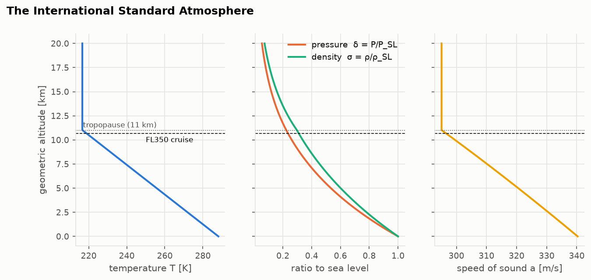
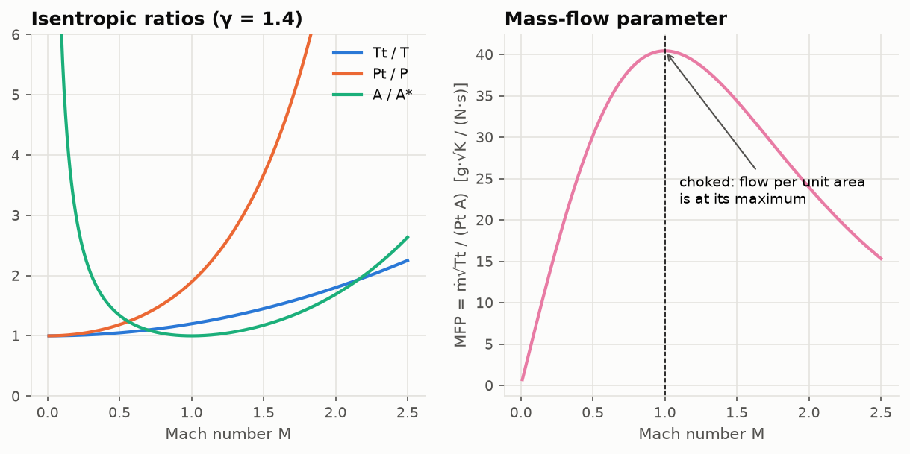

# Lesson 1 · The air an engine breathes

> *An engine on the wing at 35,000 ft swallows air at −54 °C and less than a quarter of
> sea-level pressure. It moves through that air at 230 m/s. Before we can model the engine, we
> need to describe the air: how cold, how thin, how fast, and how much of it fits through a hole.*

**Code:** [`src/propulsion/atmosphere/`](../../src/propulsion/atmosphere),
[`src/propulsion/gas/`](../../src/propulsion/gas) ·
**Notebook:** [`01_atmosphere_and_gas.ipynb`](../../notebooks/01_atmosphere_and_gas.ipynb) ·
**Next:** [Lesson 2 — The ideal Brayton cycle](02-ideal-brayton-cycle.md)

## Learning objectives

By the end of this lesson you should be able to

1. derive the International Standard Atmosphere from hydrostatics and the perfect-gas law;
2. tell geometric, geopotential and pressure altitude apart, and say which one a flight level is;
3. explain why cycle analysis uses two perfect gases, a cold one and a hot one;
4. convert between static and stagnation properties, and read the "ram" ratios τr and πr;
5. derive the mass-flow parameter, explain choking, and use corrected flow to compare engines
   running at different altitudes.

---

## 1. Why the atmosphere comes first

Every number an engine produces depends on the air at its inlet:
- thrust is momentum flux, so it scales with how much mass the engine can swallow, which depends
  on density;
- the work a compressor must do to reach a given pressure scales with inlet temperature;
- the turbine-inlet temperature limit is fixed by metallurgy, so the colder the inlet air, the
  more temperature rise the cycle can use.

Real air varies every day. Engineers therefore compare engines in a *standard* atmosphere and
correct their measurements to it. That standard is the ISA, defined in ICAO Doc 7488 and
identical below 32 km to the US Standard Atmosphere 1976.

## 2. Building the standard atmosphere

The ISA is a *definition*, not a fit to data. It has two physical ingredients.

**Hydrostatic balance.** A slab of air of thickness dH is held up by the pressure difference
across it:

```math
\frac{dP}{dH} = -\rho g_0
```

**The perfect-gas law**, $P = \rho R T$. Divide one by the other and ρ disappears:

```math
\frac{dP}{P} = -\frac{g_0}{R\,T(H)}\,dH
```

The third ingredient is the *defined* temperature profile: piecewise linear, with lapse rate
λ = dT/dH:

| Layer | Base H [m] | Base T [K] | λ [K/m] |
|---|---|---|---|
| Troposphere | 0 | 288.15 | −0.0065 |
| Tropopause | 11,000 | 216.65 | 0 |
| Lower stratosphere | 20,000 | 216.65 | +0.001 |

Integrate dP/P inside each layer, starting from the base values $(H_b, T_b, P_b)$:

```math
\lambda \neq 0:\quad \frac{P}{P_b} = \left(\frac{T}{T_b}\right)^{-g_0/(R\lambda)}, \qquad
\lambda = 0:\quad \frac{P}{P_b} = \exp\left[-\frac{g_0 (H - H_b)}{R\,T_b}\right]
```

In the troposphere the exponent is $g_0/(R\lambda) = 5.256$. Density follows from the gas law,
and the speed of sound is $a = \sqrt{\gamma R T}$. At sea level $P_{SL}$ = 101,325 Pa,
$T_{SL}$ = 288.15 K, $\rho_{SL}$ = 1.225 kg/m³ and $a_{SL}$ = 340.29 m/s.



Look at the shape of the figure:
- temperature falls linearly until the tropopause, then stays constant;
- pressure and density fall roughly exponentially, with density falling a little more slowly in
  the troposphere because the air is also getting colder;
- the speed of sound follows $\sqrt T$, so above 11 km it no longer changes.

That is why airliners cruise just around the tropopause. The air is thin, so drag is low, and it
is as cold as it gets, which (Lesson 2) makes the engine more efficient.

### Three altitudes

- **Geometric altitude** z is what a tape measure would give.
- **Geopotential altitude** H is the height in a fictitious uniform gravity field $g_0$ with the
  same potential energy. With Earth radius $r_0$ = 6,356,766 m,
  $H = r_0 z / (r_0 + z)$. At 11 km the two differ by 19 m. The ISA layers are defined in H.
- **Pressure altitude** is the ISA altitude that has the measured pressure. An altimeter set to
  1013.25 hPa reads pressure altitude, and **flight levels are pressure altitudes**. FL350 means
  "the pressure the ISA has at 35,000 ft of geopotential altitude", whatever the real temperature.

### Non-standard days

Engines are certified for hot days. An **ISA+ΔT day** shifts the whole temperature profile by
ΔT but keeps the pressure–altitude relation. A hotter day at the same pressure therefore has
lower density. Engine data is normalised with the ratios

```math
\theta = \frac{T}{T_{SL}}, \qquad \delta = \frac{P}{P_{SL}}, \qquad \sigma = \frac{\rho}{\rho_{SL}} = \frac{\delta}{\theta}
```

which we will meet again as the "corrected" parameters of Section 6.

## 3. The working fluid: two perfect gases

Inside an engine we treat the gas as **calorically perfect**: constant $c_p$ and γ, so enthalpy
is $h = c_p T$, and

```math
R = c_p\,\frac{\gamma - 1}{\gamma}, \qquad c_v = \frac{c_p}{\gamma}
```

Real gas properties are not constant. $c_p$ of air rises from about 1.00 kJ/(kg·K) at room
temperature to about 1.15 kJ/(kg·K) at 1,000 K, and burning fuel adds CO₂ and H₂O, which raise
it further. A single constant $c_p$ for the whole engine would get the turbine badly wrong.

The standard compromise (Mattingly, *Elements of Propulsion*, Ch. 7) is to use **two** perfect
gases:

| Section | Stations | $c_p$ [J/(kg·K)] | γ | R [J/(kg·K)] |
|---|---|---|---|---|
| Cold: inlet, fan, compressors | 0 → 3 | 1004 | 1.40 | 286.9 |
| Hot: burner exit, turbines, nozzle | 4 → 9 | 1239 | 1.30 | 285.9 |

These are **modelling assumptions** taken from that textbook's examples, not measurements of any
engine. The code calls them `AIR` and `COMBUSTION_GAS`. The fuel is Jet-A with a heating value
$h_{PR}$ = 42.8 MJ/kg.

## 4. Stagnation properties

Bring a flowing gas to rest adiabatically. The steady energy equation says the total enthalpy
is conserved:

```math
h + \frac{V^2}{2} = h_t \quad\Longrightarrow\quad T_t = T + \frac{V^2}{2 c_p}
```

Write $V = M a = M\sqrt{\gamma R T}$ and use $c_p = \gamma R/(\gamma - 1)$:

```math
\frac{T_t}{T} = 1 + \frac{\gamma - 1}{2} M^2
```

If the deceleration is also reversible (isentropic), the pressure rises with it:

```math
\frac{P_t}{P} = \left(\frac{T_t}{T}\right)^{\gamma/(\gamma-1)} = \left(1 + \frac{\gamma - 1}{2} M^2\right)^{\gamma/(\gamma-1)}
```

Two facts make stagnation properties the natural language of engines:

1. **$T_t$ only changes when work or heat crosses the boundary.** A compressor raises $T_t$
   by exactly its work per unit mass divided by $c_p$. A duct leaves $T_t$ alone, whatever it
   does to the velocity.
2. **$P_t$ only rises if work is done.** Every irreversibility (friction, shocks, mixing) loses
   $P_t$. A stagnation-pressure ratio below one is a direct measure of loss.

In flight the free stream (station 0) already carries stagnation enthalpy relative to the engine.
Mattingly calls the free-stream ratios the **ram** ratios:

```math
\tau_r = \frac{T_{t0}}{T_0} = 1 + \frac{\gamma_c - 1}{2} M_0^2, \qquad \pi_r = \frac{P_{t0}}{P_0} = \tau_r^{\gamma_c/(\gamma_c-1)}
```

At M 0.78, πr ≈ 1.49: the engine gets a 49 % pressure rise for free, before the fan does
anything. This is also why a pilot's *total* air temperature (TAT) reads warmer than the
*static* air temperature (SAT): the probe brings the air to rest.

### Entropy

For the T–s diagrams of Lesson 2 we need the Gibbs equation for a perfect gas:

```math
s_2 - s_1 = c_p \ln\frac{T_2}{T_1} - R \ln\frac{P_2}{P_1}
```

It applies to stagnation states too, because stagnating a flow isentropically does not change
its entropy. A process with $T_2/T_1 = (P_2/P_1)^{(\gamma-1)/\gamma}$ has Δs = 0.

## 5. Mass flow through a hole: the mass-flow parameter

How much air passes through an area A? Start from $\dot m = \rho V A$ and express everything with
stagnation quantities and Mach number:

```math
\dot m = \frac{P}{R T}\,M\sqrt{\gamma R T}\,A
\quad\Longrightarrow\quad
\frac{\dot m\sqrt{T_t}}{P_t\,A} = M\sqrt{\frac{\gamma}{R}}\left(1 + \frac{\gamma - 1}{2}M^2\right)^{-\frac{\gamma+1}{2(\gamma-1)}}
```

The right-hand side is the **mass-flow parameter** MFP(M). It depends only on the Mach number and
the gas.



Two consequences carry the rest of the course:

- **MFP peaks at M = 1.** No more mass per unit area can pass a section than at sonic speed. A
  throat at M = 1 is **choked**: lowering the downstream pressure further cannot pull more flow
  through. The ratio $\mathrm{MFP}(M)/\mathrm{MFP}(1) = A^{\ast}/A$ is the area–Mach relation that
  shapes every nozzle.
- **A choked throat fixes $\dot m\sqrt{T_t}/P_t$.** The first turbine nozzle of a gas turbine is
  choked over most of the operating range, so its flow capacity is a constant. In Lesson 5 that
  single fact turns off-design analysis into a solvable problem.

### Corrected flow

Divide the MFP equation by its sea-level-static value. For a fixed geometry running at a given
Mach number, the **corrected mass flow**

```math
\dot m_c = \frac{\dot m\sqrt{\theta_t}}{\delta_t}, \qquad \theta_t = \frac{T_t}{T_{SL}}, \quad \delta_t = \frac{P_t}{P_{SL}}
```

is the same at any altitude, speed or temperature. This is why compressor maps, and engine test
data, are always plotted in corrected quantities. Corrected spool speed $N/\sqrt{\theta_t}$ plays
the same role for rotation.

## 6. Worked example: cruise at FL350, Mach 0.78

A narrow-body airliner cruises at FL350, Mach 0.78, on a standard day.

1. **Atmosphere.** FL350 is a pressure altitude, so we evaluate the ISA at 35,000 ft geopotential
   = 10,668 m. This gives $T_0$ = 218.81 K (−54.3 °C), $P_0$ = 23,842 Pa (δ = 0.2353),
   $\rho_0$ = 0.3796 kg/m³ (σ = 0.310) and $a_0$ = 296.5 m/s.
2. **Flight speed.** $V_0 = 0.78\times 296.5$ = 231.3 m/s (450 kt).
3. **Ram ratios.** τr = 1 + 0.2(0.78)² = 1.1217 and πr = 1.4947. The fan face sees
   $T_{t0}$ = 245.4 K and $P_{t0}$ = 35,636 Pa.
4. **Mass flow.** Assume a fan face of area 1.6 m² that the engine runs at $M_2$ = 0.6.
   MFP(0.6) = 0.03402 kg·K^½/(N·s).
   - At sea-level static: $\dot m = 0.03402 \times 101{,}325 \times 1.6 / \sqrt{288.15}$ = 325 kg/s.
   - At cruise: $\dot m = 0.03402 \times 35{,}636 \times 1.6 / \sqrt{245.4}$ = 124 kg/s, only 38 %
     of the sea-level value.
5. **Corrected flow.** At cruise θt2 = 0.8518 and δt2 = 0.3517, so
   $\dot m_c = 124\sqrt{0.8518}/0.3517$ = 325 kg/s. This is identical to the sea-level value,
   because the Mach number is the same. The engine "feels" the same corrected condition. Only the
   physical flow, and with it the thrust, has shrunk.

```python
import numpy as np

from propulsion.atmosphere import isa
from propulsion.gas import AIR, mass_flow_parameter, stagnation_pressure_ratio
from propulsion.units import FT

a = isa(35000 * FT, geopotential=True)  # flight levels are pressure altitudes
pi_r = stagnation_pressure_ratio(0.78, 1.4)  # 1.4947
Tt0, Pt0 = a.T * (1 + 0.2 * 0.78**2), a.P * pi_r  # 245.4 K, 35 636 Pa
mdot = mass_flow_parameter(0.6, AIR) * Pt0 * 1.6 / np.sqrt(Tt0)  # 123.8 kg/s
```

One caution about consistency. The ISA uses R = 287.05 J/(kg·K) while `AIR` uses 286.86. The
0.07 % difference does not matter for cycle analysis, but it is why the code never mixes the
atmosphere's speed of sound into the engine's gas model.

## 7. From equations to code

| Concept | Function |
|---|---|
| ISA state (T, P, ρ, a, θ, δ, σ), ISA+ΔT | `isa(h, dT=0, geopotential=False)` |
| geometric → geopotential | `geometric_to_geopotential(z)` |
| pressure altitude | `pressure_altitude(P)` |
| perfect gas, cold and hot | `Gas(cp, gamma)`, `AIR`, `COMBUSTION_GAS`, `H_PR_JET_A` |
| Tt/T, Pt/P and their inverses | `stagnation_temperature_ratio`, `stagnation_pressure_ratio`, `mach_from_pressure_ratio` |
| area–Mach relation | `area_ratio`, `mach_from_area_ratio` |
| mass-flow parameter | `mass_flow_parameter(M, gas)` |
| entropy change | `entropy_change(gas, T1, P1, T2, P2)` |
| unit conversions (exact) | `propulsion.units`: `LBF`, `FT`, `tsfc_to_lb_per_lbf_h` |

The tests ([`tests/test_atmosphere.py`](../../tests/test_atmosphere.py),
[`tests/test_gas.py`](../../tests/test_gas.py)) check the ISA against the US 1976 tables. They
also check hydrostatic balance by finite differences, every inverse function by round trip, and
the isentropic ratios against Anderson's tables.

A first lesson in data honesty came up here. ICAO prints R = 287.05287 J/(kg·K), while the
US 1976 standard defines R through R* = 8314.32 J/(kmol·K) and M0 = 28.9644 kg/kmol, which gives
287.05307. The 7×10⁻⁷ difference shows up in the seventh digit of the tabulated pressures. The
code uses the US 1976 definition, and so matches its tables to every printed digit.

## 8. Common pitfalls

- **Geometric vs pressure altitude.** FL350 is not "10,668 m above the ground". It is a pressure.
  On a cold day the aircraft is physically lower.
- **Static vs stagnation.** Compressor pressure ratios, turbine temperatures and the MFP all use
  stagnation values. Mixing a static $P_0$ into a stagnation ratio is the most common
  cycle-analysis bug.
- **Celsius in a ratio.** θ = T/288.15 needs kelvin. −54 °C / 15 °C is not a temperature ratio.
- **One γ for everything.** γ = 1.4 in a turbine at 1,500 K overstates the expansion work. Use
  the hot-gas properties after the burner.
- **"Choked" means sonic at the throat**, not "no flow". A choked nozzle passes the *most*
  flow it can.

## 9. Exercises

1. Find T, P, ρ and a at 5,000 m and at 15,000 m geometric altitude.
2. A static-pressure port reads 30.0 kPa. What is the pressure altitude, in metres and in feet,
   and what flight level is it?
3. An aircraft flies at Mach 0.85 at FL390 on a standard day. Find the static air temperature,
   the total air temperature, and the airspeed. Why is TAT the number the engine "sees"?
4. Differentiate MFP(M) and show that it is maximum at M = 1 for any γ.
5. A turbine nozzle throat of 0.30 m² is choked with hot gas (γ = 1.3, $c_p$ = 1239 J/(kg·K))
   at $T_t$ = 900 K and $P_t$ = 250 kPa. What is the mass flow?
6. On an ISA+15 day at sea level, by how much does density fall? A fan runs at the same face
   Mach number. By what factor does its physical mass flow change?

<details>
<summary>Answers</summary>

1. 5,000 m: T = 255.68 K, P = 54,048 Pa, ρ = 0.7364 kg/m³, a = 320.5 m/s.
   15,000 m: T = 216.65 K, P = 12,112 Pa, ρ = 0.1948 kg/m³, a = 295.1 m/s.
2. In the troposphere, invert $P/P_{SL} = (T/T_{SL})^{5.256}$: H = 9,164 m geopotential =
   30,065 ft, so about FL300. The geometric altitude is 9,177 m.
3. FL390 is above the tropopause, so SAT = 216.65 K (−56.5 °C).
   TAT = 216.65 × (1 + 0.2 × 0.85²) = 247.96 K (−25.2 °C).
   V = 0.85 × 295.07 = 250.8 m/s. The engine decelerates the air before using it, so its
   inlet works with the stagnation temperature, TAT.
4. Write MFP ∝ $M(1 + kM^2)^{-n}$ with k = (γ−1)/2 and n = (γ+1)/(2(γ−1)). The derivative is
   $(1+kM^2)^{-n-1}[1 + kM^2 - 2nkM^2]$. Since 2nk = (γ+1)/2, the bracket vanishes when
   $M^2[(\gamma+1)/2 - (\gamma-1)/2] = 1$, i.e. M = 1.
5. MFP(1) = 0.03946 for this gas, so $\dot m$ = 0.03946 × 250,000 × 0.30 / √900 = 98.7 kg/s.
6. At the same pressure, ρ ∝ 1/T: 288.15/303.15 = 0.9505, a 5 % drop (1.164 kg/m³).
   At fixed Mach number, $\dot m \propto P_t/\sqrt{T_t}$, so the flow falls by
   √(288.15/303.15) = 0.975, 2.5 %. The corrected flow is unchanged. This is one reason hot-day
   takeoff thrust is lower.

</details>

## Key takeaways

- The ISA is two equations (hydrostatics and the gas law) and a defined temperature profile.
  Everything else is integration.
- Flight levels are pressure altitudes. Engines are compared on standard days and corrected
  to them with θ and δ.
- Inside the engine, think in stagnation quantities. $T_t$ measures energy and $P_t$ measures
  the absence of loss.
- The mass-flow parameter links flow, area, $P_t$ and $T_t$. Its maximum at M = 1 (choking)
  and corrected flow are the two ideas that make off-design analysis possible.

## Further reading

- ICAO Doc 7488/3, *Manual of the ICAO Standard Atmosphere*; NOAA/NASA/USAF, *U.S. Standard
  Atmosphere, 1976*.
- J. D. Mattingly, *Elements of Propulsion: Gas Turbines and Rockets*, 2nd ed., Ch. 2–3.
- J. D. Anderson, *Modern Compressible Flow*, Ch. 3 and 5.
- P. Hill & C. Peterson, *Mechanics and Thermodynamics of Propulsion*, Ch. 2–3.
