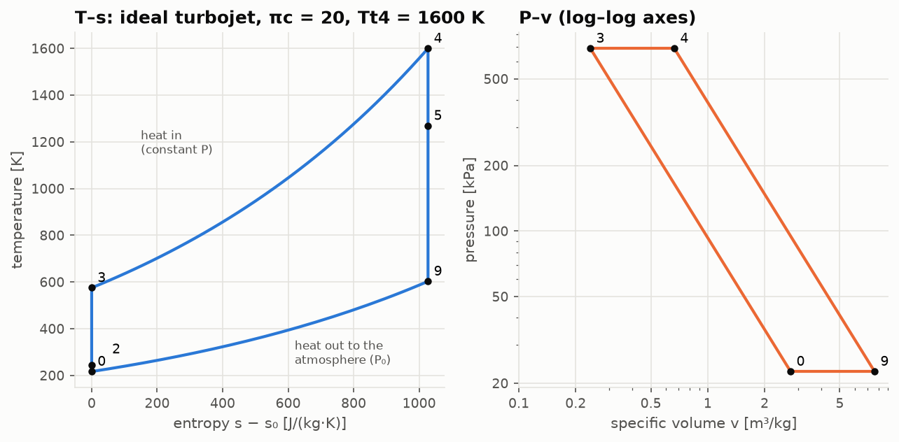
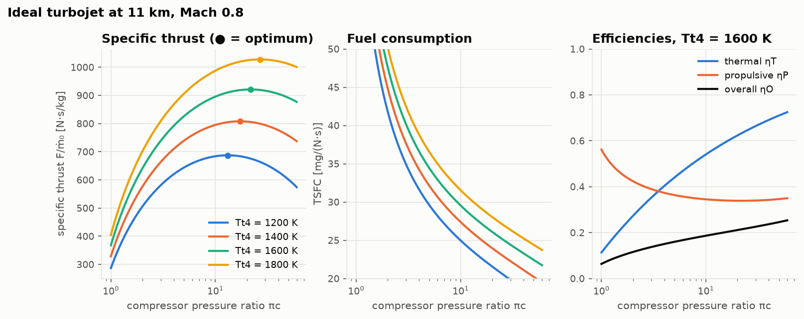
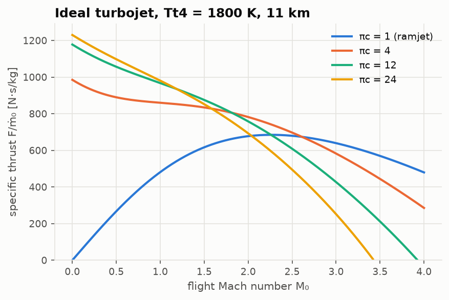

# Lesson 2 · The ideal Brayton cycle and the turbojet

> *A turbojet is a heat engine that does not deliver its work to a shaft. It delivers it to
> the air, as a faster jet. How much thrust can a kilogram of air give, and how much fuel does
> that cost? With perfect components, both answers fit on one page.*

**Code:** [`src/propulsion/brayton_cycle/`](../../src/propulsion/brayton_cycle) ·
**Previous:** [Lesson 1 — The air an engine breathes](01-atmosphere-and-compressible-flow.md) ·
**Next:** [Lesson 3 — Real components](03-real-components.md)

## Learning objectives

By the end of this lesson you should be able to

1. derive the thermal efficiency and net work of the ideal Brayton cycle, and explain why they
   peak at different pressure ratios;
2. derive the thrust equation from a momentum balance;
3. carry out a parametric analysis of the ideal turbojet with Mattingly's τ notation;
4. split overall efficiency into thermal and propulsive parts, and explain the conflict
   between specific thrust and propulsive efficiency;
5. find the compressor pressure ratio of maximum specific thrust, and explain why fast
   aircraft need less compression, down to none at all (the ramjet).

---

## 1. The Brayton cycle

Every gas turbine runs the same four processes:

| Process | Stations | Ideal model |
|---|---|---|
| Compression (inlet + compressor) | 0 → 3 | isentropic |
| Heat addition (burner) | 3 → 4 | constant pressure |
| Expansion (turbine + nozzle) | 4 → 9 | isentropic |
| Heat rejection (the atmosphere) | 9 → 0 | constant pressure, outside the engine |

The fourth process happens outside the engine. The hot exhaust mixes with the atmosphere and
cools at ambient pressure. That makes a jet engine an **open** cycle. Thermodynamically, though,
it is the same closed Brayton cycle drawn in every textbook.



In the T–s diagram both compression and expansion are vertical (no entropy change). Heat enters
along the upper isobar and leaves along the lower one. The two isobars diverge as entropy grows,
so the expansion 4 → 9 covers a larger temperature drop than the compression 0 → 3. That
difference is the net work.

### Thermal efficiency

Heat in is $c_p(T_4 - T_3)$ and heat out is $c_p(T_9 - T_0)$. Both isentropes span the same
pressure ratio, so $T_3/T_0 = T_4/T_9 = \tau$, where $\tau = \pi^{(\gamma-1)/\gamma}$ is the
overall compression temperature ratio. Then

```math
\eta_{th} = 1 - \frac{T_9 - T_0}{T_4 - T_3} = 1 - \frac{T_0(T_4/T_3) - T_0}{\tau T_0 (T_4/T_3) - \tau T_0} = 1 - \frac{1}{\tau}
```

**The ideal Brayton efficiency depends only on the pressure ratio.** It does not depend on how
hot the burner runs. This is the first reason why engine pressure ratios have climbed from about
5 in the 1940s to over 40 today.

### Net work and its optimum

Define the cycle temperature ratio $\tau_\lambda = T_4/T_0$, the hottest temperature over the
coldest. The net work is turbine work minus compressor work:

```math
\frac{w_{net}}{c_p T_0} = \tau_\lambda\left(1 - \frac{1}{\tau}\right) - (\tau - 1)
```

This vanishes at τ = 1 (no compression) and at τ = τλ (so much compression that no heat can be
added). In between it peaks where $dw/d\tau = 0$:

```math
\tau^{\ast} = \sqrt{\tau_\lambda} \quad\Longleftrightarrow\quad T_3 = T_9
```

So efficiency keeps rising with pressure ratio, but work per kilogram has a maximum. A designer
pushing for efficiency eventually pays in engine size, because less work per kilogram means more
kilograms for the same power. Raising $T_4$ raises $\tau_\lambda$, which raises both the
optimum pressure ratio and the work available there. That is why turbine-inlet temperature is the
other great driver of engine progress.

## 2. Thrust from momentum

Draw a control volume around the engine. Air enters at $V_0$ with mass flow $\dot m_0$, fuel
$\dot m_f$ is added, and the jet leaves at $V_9$ through area $A_9$ at static pressure $P_9$.
The momentum balance gives the **uninstalled thrust**

```math
F = (\dot m_0 + \dot m_f)V_9 - \dot m_0 V_0 + (P_9 - P_0)A_9
```

For an ideal nozzle that expands fully ($P_9 = P_0$), and with the fuel mass neglected
($f = \dot m_f/\dot m_0 \ll 1$, which the ideal analysis does), the **specific thrust** is simply

```math
\frac{F}{\dot m_0} = V_9 - V_0
```

Specific thrust has units of velocity (N·s/kg = m/s). It tells you how big the engine must be:
high specific thrust means a small, light engine for a given thrust.

## 3. Parametric analysis of the ideal turbojet

Mattingly's method names every temperature and pressure ratio:

```math
\tau_r = 1 + \frac{\gamma - 1}{2}M_0^2, \qquad \tau_c = \pi_c^{(\gamma-1)/\gamma}, \qquad \tau_\lambda = \frac{T_{t4}}{T_0}
```

The inputs are flight condition ($M_0$, $T_0$), design choices ($\pi_c$, $T_{t4}$) and the fuel
($h_{PR}$). The analysis goes station by station.

**Turbine.** The turbine exists only to drive the compressor, so the two works are equal:

```math
c_p(T_{t3} - T_{t2}) = c_p(T_{t4} - T_{t5}) \quad\Longrightarrow\quad \tau_t = 1 - \frac{\tau_r}{\tau_\lambda}(\tau_c - 1)
```

**Nozzle.** The flow expands isentropically from $P_{t9} = P_0\pi_r\pi_c\pi_t$ to $P_0$, so
$T_{t9}/T_9 = \tau_r\tau_c\tau_t$. With $T_{t9} = T_{t5} = T_0\tau_\lambda\tau_t$ and
$V_9^2 = 2c_p(T_{t9} - T_9)$:

```math
\left(\frac{V_9}{a_0}\right)^2 = \frac{2}{\gamma - 1}\,\frac{\tau_\lambda}{\tau_r\tau_c}\left(\tau_r\tau_c\tau_t - 1\right)
```

using $c_pT_0 = a_0^2/(\gamma - 1)$. Specific thrust follows as $F/\dot m_0 = a_0(V_9/a_0 - M_0)$.

**Burner.** The fuel energy heats the air from $T_{t3}$ to $T_{t4}$:

```math
f\,h_{PR} = c_p(T_{t4} - T_{t3}) \quad\Longrightarrow\quad f = \frac{c_p T_0}{h_{PR}}\left(\tau_\lambda - \tau_r\tau_c\right), \qquad S = \frac{f}{F/\dot m_0}
```

S is the **thrust-specific fuel consumption** (TSFC): kilograms of fuel per second per newton of
thrust. In the code `tsfc` is in kg/(N·s), and helpers convert to mg/(N·s) and lb/(lbf·h).

## 4. Three efficiencies

The fuel power $\dot m_f h_{PR}$ becomes kinetic energy of the jets. Part of that kinetic energy
becomes useful thrust power $F V_0$.

```math
\eta_T = \frac{\dot m_0 (V_9^2 - V_0^2)/2}{\dot m_f h_{PR}} = 1 - \frac{1}{\tau_r\tau_c}, \qquad
\eta_P = \frac{F V_0}{\dot m_0 (V_9^2 - V_0^2)/2} = \frac{2}{1 + V_9/V_0}, \qquad
\eta_O = \eta_T\,\eta_P = \frac{F V_0}{\dot m_f h_{PR}}
```

The thermal efficiency is the Brayton result, with ram compression $\tau_r$ counted alongside
the compressor's $\tau_c$. (Proving this from the definitions is Exercise 2.)

**Propulsive efficiency** is the key idea of the whole course. Thrust needs $V_9 > V_0$, but every
bit of excess jet speed leaves the engine as kinetic energy in the wake. That energy is wasted.
$\eta_P \to 1$ only as $V_9 \to V_0$, where the specific thrust goes to zero.

> **High specific thrust and high propulsive efficiency are in direct conflict.** A turbojet
> gives a small engine with a fast, wasteful jet. Lesson 4 shows how the turbofan escapes this
> by accelerating much more air, much less.

## 5. Optimum compressor pressure ratio

Maximise $(V_9/a_0)^2$ over $\tau_c$. Setting the derivative to zero gives

```math
\tau_c^{\ast} = \frac{\sqrt{\tau_\lambda}}{\tau_r} \quad\Longrightarrow\quad T_9 = T_{t3}
```

This is the open-cycle version of $T_3 = T_9$ from Section 1. Two consequences follow:

- **Hotter turbines want more compression.** $\tau_c^{\ast}$ grows like $\sqrt{T_{t4}}$.
- **Faster flight wants less compression.** The ram rise $\tau_r$ already does part of the job.
  Above some Mach number $\tau_c^{\ast} < 1$: the best compressor is no compressor. This is the
  **ramjet**.



The sweep shows the textbook picture:
- specific thrust peaks at a modest $\pi_c$ (● markers) and rises with $T_{t4}$;
- TSFC keeps falling well past that peak, so real engines are designed at pressure ratios
  *above* the specific-thrust optimum, trading engine size for fuel;
- at fixed $\pi_c$, **raising $T_{t4}$ raises TSFC** in the ideal turbojet. Thermal efficiency
  does not change, but the faster jet lowers propulsive efficiency.



As flight Mach rises, high-pressure-ratio cycles lose thrust fastest: there is less room for
burner heat before $T_{t3}$ reaches $T_{t4}$. The ramjet overtakes the $\pi_c$ = 24 engine at
Mach 2.04, the $\pi_c$ = 12 engine at Mach 2.26 and the $\pi_c$ = 4 engine at Mach 2.61.

## 6. Worked example: ideal turbojet at 11 km, Mach 0.8

Take a standard day at 11 km (geopotential), $M_0$ = 0.8, $\pi_c$ = 20 and $T_{t4}$ = 1600 K.
Use $c_p$ = 1004 J/(kg·K), γ = 1.4 and $h_{PR}$ = 42.8 MJ/kg.

1. **Free stream.** $T_0$ = 216.65 K, $P_0$ = 22,632 Pa, $a_0$ = 294.97 m/s, $V_0$ = 235.98 m/s.
2. **Ratios.** τr = 1.128, πr = 1.5243, τc = 20^0.2857 = 2.3535, τλ = 1600/216.65 = 7.3852.
3. **Turbine.** τt = 1 − (1.128/7.3852)(2.3535 − 1) = 0.79326.
4. **Stations.**
   - $T_{t2}$ = 244.4 K
   - $T_{t3}$ = 575.2 K, $P_{t3}$ = 690.0 kPa
   - $T_{t5}$ = 1269.2 K, $P_{t5}$ = 306.8 kPa
   - $T_9$ = 602.7 K
5. **Jet.** $V_9/a_0$ = 3.922, so $V_9$ = 1156.9 m/s and $F/\dot m_0$ = 920.9 N·s/kg.
6. **Fuel.** f = 1004 × 216.65 × (7.3852 − 1.128 × 2.3535)/42.8×10⁶ = 0.02404.
   S = 0.02404/920.9 = 26.10 mg/(N·s) = 0.922 lb/(lbf·h).
7. **Efficiencies.** ηT = 1 − 1/(1.128 × 2.3535) = 62.3 %. ηP = 2/(1 + 1156.9/235.98) = 33.9 %.
   ηO = 21.1 %.
8. **Size.** For 46 kN of thrust the engine needs 46,000/920.9 = 50 kg/s of air.

The optimum pressure ratio for this $T_{t4}$ and flight condition is 21.7. There the specific
thrust is 921.2 N·s/kg, only 0.03 % more, because the peak is very flat. TSFC is 25.75 mg/(N·s).
Notice how poor the propulsive efficiency is: two-thirds of the jet's kinetic energy is wasted.

```python
from propulsion.brayton_cycle import ideal_turbojet, optimum_compressor_pressure_ratio
from propulsion.flight import FlightCondition
from propulsion.units import tsfc_to_lb_per_lbf_h

cruise = FlightCondition.at_altitude(11000.0, 0.8, geopotential=True)
p = ideal_turbojet(cruise, pi_c=20.0, Tt4=1600.0)
p.specific_thrust, p.f, tsfc_to_lb_per_lbf_h(p.tsfc)  # 920.9 N s/kg, 0.02404, 0.922
p.eta_thermal, p.eta_propulsive, p.eta_overall  # 0.623, 0.339, 0.211
optimum_compressor_pressure_ratio(cruise, 1600.0)  # 21.70
```

## 7. From equations to code

| Concept | Function |
|---|---|
| free stream, τr, πr, $a_0$, $V_0$ | `FlightCondition(M0, T0, P0)`, `FlightCondition.at_altitude(h, M0)` |
| closed-cycle efficiency and work | `brayton_thermal_efficiency`, `brayton_specific_work`, `brayton_optimum_tau` |
| ideal turbojet (broadcasts over πc, Tt4) | `ideal_turbojet(flight, pi_c, Tt4)` → `CyclePerformance` |
| optimum πc | `optimum_compressor_pressure_ratio(flight, Tt4)` |
| station states and T–s path | `CyclePerformance.stations`, `ts_diagram(perf)` |

The tests ([`tests/test_brayton_cycle.py`](../../tests/test_brayton_cycle.py)) do not compare
against anyone's numbers. They check the *identities* of the ideal cycle, which must hold exactly:
- turbine work equals compressor work;
- kinetic-energy gain over fuel energy equals $1 - 1/(\tau_r\tau_c)$;
- $\eta_O = \eta_T\eta_P$;
- stations 0, 2 and 3 share one entropy, as do 4, 5 and 9;
- a brute-force search over 400,000 pressure ratios finds the closed-form optimum;
- $T_9 = T_{t3}$ there;
- f and thrust vanish together when $\tau_r\tau_c = \tau_\lambda$.

## 8. Common pitfalls

- **Forgetting ram compression.** The cycle's pressure ratio is $\pi_r\pi_c$, not $\pi_c$. At
  Mach 0.8 the ram rise is 52 %.
- **Using $T_{t4}/T_{t2}$ for τλ.** Mattingly defines τλ with the *static* free-stream $T_0$, and
  all the formulas above depend on it.
- **"Hotter is always better."** Not for TSFC of an ideal turbojet at fixed $\pi_c$ (Section 5).
  Higher $T_{t4}$ pays off only if the pressure ratio, or the bypass ratio (Lesson 4), rises with it.
- **Specific thrust is not thrust.** Thrust is $\dot m_0 \times F/\dot m_0$. Engine size enters
  through $\dot m_0$.
- **The 1-f approximation.** Ideal analysis neglects the fuel mass in the momentum balance (a
  2–3 % effect). The real-cycle model of Lesson 3 keeps it.

## 9. Exercises

1. A closed Brayton cycle has π = 30. Find its thermal efficiency. Compare it with a Carnot
   engine working between 288.15 K and 1600 K, and explain the difference.
2. Starting from $\eta_T = \frac{1}{2}(V_9^2 - V_0^2)/(f h_{PR})$, prove that
   $\eta_T = 1 - 1/(\tau_r\tau_c)$ for the ideal turbojet.
3. With $T_{t4}$ = 1600 K, find the optimum compressor pressure ratio at sea-level static, at
   Mach 2 at 11 km, and at Mach 3 at 11 km. What does the last answer mean?
4. An ideal ramjet ($\pi_c$ = 1) flies at Mach 3 at 11 km with $T_{t4}$ = 1800 K. Find its specific
   thrust, f, TSFC and its three efficiencies.
5. In the worked example, change $T_{t4}$ to 1400 K and to 1800 K. Tabulate specific thrust, TSFC,
   ηT and ηP, and explain why TSFC *rises* with turbine temperature.

<details>
<summary>Answers</summary>

1. η = 1 − 30^(−0.2857) = 62.2 %. Carnot: 1 − 288.15/1600 = 82.0 %. Brayton adds heat over a
   range of temperatures (575 → 1600 K here), not all at the maximum, and rejects it over a
   range too. Its *mean* hot temperature is far below 1600 K.
2. With $c_pT_0 = a_0^2/(\gamma-1)$: $V_9^2/(2c_pT_0) = \tau_\lambda\tau_t - \tau_\lambda/(\tau_r\tau_c)$
   and $V_0^2/(2c_pT_0) = \tau_r - 1$. Substitute $\tau_\lambda\tau_t = \tau_\lambda - \tau_r(\tau_c-1)$:
   the kinetic-energy gain is $c_pT_0(\tau_\lambda - \tau_r\tau_c)(1 - 1/(\tau_r\tau_c))$. The fuel
   energy is $f h_{PR} = c_pT_0(\tau_\lambda - \tau_r\tau_c)$. Divide.
3. Sea-level static: 20.1. Mach 2: 4.23. Mach 3: 0.90. At Mach 3 the ram compression already
   exceeds the optimum, so $\tau_c^{\ast} < 1$ and any compressor would *reduce* specific thrust.
   The ideal engine is a ramjet.
4. $F/\dot m_0$ = 639.4 N·s/kg, f = 0.0280, S = 43.8 mg/(N·s). ηT = 1 − 1/τr = 64.3 %,
   ηP = 73.5 %, ηO = 47.2 %. The thermal efficiency comes entirely from ram compression.
5. | Tt4 [K] | F/ṁ0 [N·s/kg] | S [mg/(N·s)] | ηT | ηP |
   |---|---|---|---|---|
   | 1400 | 807.1 | 23.97 | 62.3 % | 36.9 % |
   | 1600 | 920.9 | 26.10 | 62.3 % | 33.9 % |
   | 1800 | 1024.5 | 28.05 | 62.3 % | 31.5 % |

   ηT depends only on τrτc, so it does not change. The extra heat all goes into a faster jet,
   which is propulsively less efficient. Overall efficiency falls, so TSFC rises.

</details>

## Key takeaways

- Ideal Brayton efficiency depends only on the overall pressure ratio (ram × compressor).
  Specific work peaks at $\tau = \sqrt{\tau_\lambda}$.
- A turbojet's specific thrust is $V_9 - V_0$. The parametric analysis is five lines of algebra:
  ratios, turbine balance, nozzle, burner, efficiencies.
- Overall efficiency = thermal × propulsive. Thermal efficiency wants pressure ratio.
  Propulsive efficiency wants a slow jet.
- Fast flight needs less compression, and at high enough Mach none at all: the ramjet.

## Further reading

- J. D. Mattingly, *Elements of Propulsion*, 2nd ed., Ch. 2 (Brayton cycle) and Ch. 5 (ideal cycle
  analysis).
- P. Hill & C. Peterson, *Mechanics and Thermodynamics of Propulsion*, Ch. 5.
- H. I. H. Saravanamuttoo et al., *Gas Turbine Theory*, Ch. 2–3.
