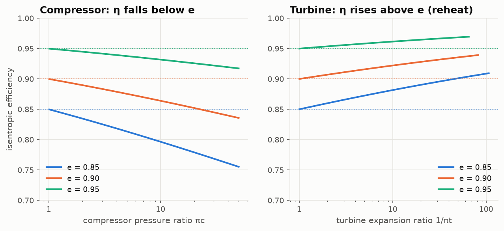
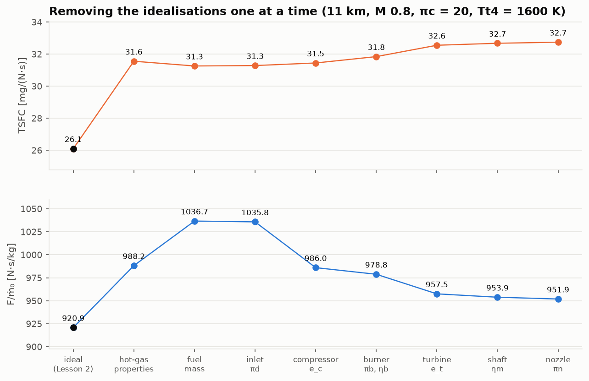
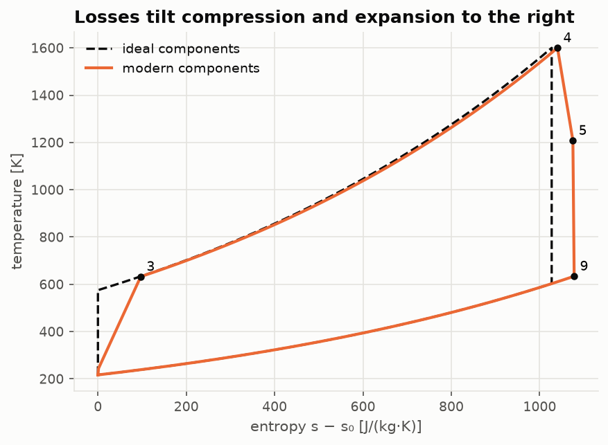
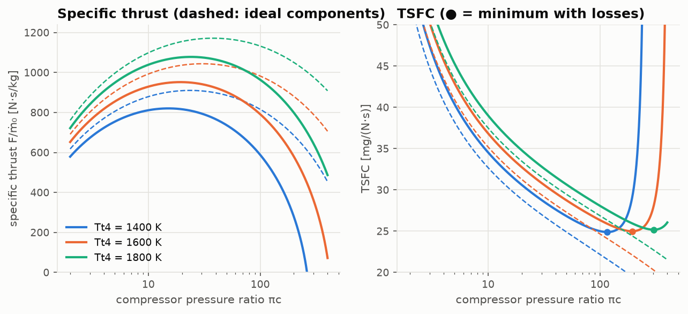

# Lesson 3 · Real components: where the losses live

> *Lesson 2's engine was perfect. Every real engine falls short of it. By how much, and which
> component is to blame? We will remove the idealisations one at a time and watch the bill
> come in. The biggest item is not a component at all.*

**Code:** [`src/propulsion/component_models/`](../../src/propulsion/component_models) ·
**Previous:** [Lesson 2 — The ideal Brayton cycle](02-ideal-brayton-cycle.md) ·
**Next:** [Lesson 4 — The turbofan](04-turbofan.md)

## Learning objectives

By the end of this lesson you should be able to

1. describe each component by one or two figures of merit and say what physical loss each
   represents;
2. derive the polytropic efficiency, and explain why a compressor's isentropic efficiency falls
   with pressure ratio while a turbine's rises;
3. write the burner energy balance with the fuel mass and two gas models;
4. prove that a fully expanded nozzle gives the most thrust, and quantify what a convergent
   nozzle costs;
5. run a non-ideal cycle analysis and rank the losses.

---

## 1. The figures of merit

Each idealisation of Lesson 2 becomes one parameter:

| Component | Ideal assumption | Real parameter | Physical loss | Value used (`Components.modern()`) |
|---|---|---|---|---|
| Inlet | isentropic | $\pi_d = \pi_{d,max}\ \eta_r(M_0)$ | wall friction, shocks | $\pi_{d,max}$ = 0.995 |
| Compressor, fan | isentropic | polytropic efficiency $e_c$, $e_f$ | blade-row friction, tip leakage, shocks | 0.90, 0.89 |
| Burner | no pressure loss, complete combustion | $\pi_b$, $\eta_b$ | flame-holder drag, heating at speed; unburnt fuel | 0.96, 0.995 |
| Turbine | isentropic | polytropic efficiency $e_t$ | as compressor, plus cooling-air mixing | 0.89 |
| Shaft | lossless | $\eta_m$ | bearings, accessory drives | 0.99 |
| Nozzle | isentropic, fully expanded | $\pi_n$, nozzle type | friction, under-expansion | 0.99 |
| Gas | one perfect gas, $f \ll 1$ | $c_{pt}$, $\gamma_t$ after the burner; $(1+f)$ kept | hot, partly burnt gas | 1239 J/(kg·K), 1.30 |

The numbers in the last column are **assumptions**. They sit inside the ranges Mattingly
(*Elements of Propulsion*, Ch. 6) tabulates for current technology, but they do not describe any
particular engine. `Components()`, with no arguments, is the ideal engine. The test suite checks
that it reproduces Lesson 2 to round-off.

## 2. The inlet

A subsonic inlet loses a little total pressure to wall friction: $\pi_{d,max}$ ≈ 0.99–0.995. A
supersonic inlet must also slow the flow through shocks, and every shock destroys total pressure.
Military specification MIL-E-5007D gives a standard ram-recovery schedule for that:

```math
\eta_r = \begin{cases} 1 & M_0 \le 1 \\ 1 - 0.075(M_0 - 1)^{1.35} & 1 < M_0 \le 5 \\ 800/(M_0^4 + 935) & M_0 > 5 \end{cases}
\qquad \pi_d = \pi_{d,max}\,\eta_r
```

At Mach 2 the shocks cost 7.5 % of the total pressure. The inlet has no effect on $T_t$, because
it does no work and adds no heat.

## 3. Compressors and turbines: polytropic efficiency

The **isentropic efficiency** compares a machine with the ideal machine of the same pressure
ratio:

```math
\eta_c = \frac{\text{ideal work}}{\text{actual work}} = \frac{\pi_c^{(\gamma-1)/\gamma} - 1}{\tau_c - 1}, \qquad
\eta_t = \frac{\text{actual work}}{\text{ideal work}} = \frac{1 - \tau_t}{1 - \pi_t^{(\gamma-1)/\gamma}}
```

It has a flaw as a design parameter: it depends on the pressure ratio. Two compressors built with
the same blading quality have different $\eta_c$ if one has more stages. The fix is to define the
efficiency of an *infinitesimal* step, the **polytropic efficiency** e:

```math
\text{compressor:}\quad \frac{dT_t}{T_t} = \frac{\gamma - 1}{\gamma\,e_c}\frac{dP_t}{P_t}
\quad\Longrightarrow\quad \tau_c = \pi_c^{(\gamma-1)/(\gamma e_c)}
```

```math
\text{turbine:}\quad \frac{dT_t}{T_t} = e_t\,\frac{\gamma - 1}{\gamma}\frac{dP_t}{P_t}
\quad\Longrightarrow\quad \pi_t = \tau_t^{\gamma/((\gamma-1)e_t)}
```

If every stage of a machine is equally well designed, e is the same for all of them, so e
measures *technology*, independent of size. Test `test_polytropic_is_the_limit_of_stage_stacking`
stacks 20,000 stages, each of isentropic efficiency e, and recovers the formula above to 10⁻⁴.



**Why compressors get worse and turbines get better.**
- In a compressor, each stage's lost work heats the gas. The next stage then has to compress
  hotter gas, which costs more work. The losses compound: this is **preheat**. At e = 0.90 the
  overall $\eta_c$ is 0.864 at πc = 10 and 0.836 at πc = 50.
- In a turbine the lost work also heats the gas, but the next stage can recover part of that heat
  as extra work: this is **reheat**. Overall $\eta_t > e_t$.

## 4. The burner, with real fuel and real gas

Write the energy balance for air $\dot m_0$ and fuel $\dot m_f = f\dot m_0$ entering, and
$(1+f)\dot m_0$ of hot gas leaving. Fuel energy is released at efficiency $\eta_b$.

Before writing it, decide where enthalpy is measured from. The heating value $h_{PR}$ is
measured with reactants and products at a reference temperature $T_{ref}$ = 298.15 K, so both
gases must measure their enthalpy from there: $h = c_p(T - T_{ref})$. The fuel enters at
$T_{ref}$ and carries no sensible enthalpy.

```math
(1 + f)\,c_{pt}(T_{t4} - T_{ref}) - c_{pc}(T_{t3} - T_{ref}) = \eta_b\,h_{PR}\,f
\quad\Longrightarrow\quad
f = \frac{c_{pt}(T_{t4} - T_{ref}) - c_{pc}(T_{t3} - T_{ref})}{\eta_b h_{PR} - c_{pt}(T_{t4} - T_{ref})}
```

Three things changed from Lesson 2.
- The exit gas has its own $c_{pt}$ (1239 vs 1004 J/(kg·K)). Reaching 1600 K now takes more
  energy, because hot gas holds more enthalpy per kelvin.
- The fuel's own mass must also be heated, which is the $-c_{pt}(T_{t4} - T_{ref})$ in the
  denominator.
- The datum matters once the two gases differ. Mattingly writes the balance with $h = c_pT$
  for each gas, i.e. each measured from 0 K. That silently counts an extra
  $(c_{pt} - c_{pc})T_{ref}$ ≈ 70 kJ/kg of heat, and burns 6–10 % too much fuel. This project
  first used that form. Lesson 5's comparison with the ICAO engine databank exposed it: no
  turbine temperature could bring the predicted take-off fuel flow down to the measured value.
  `fuel_air_ratio(..., T_ref=0)` still reproduces the textbook form.

The burner also loses total pressure. Heating a moving gas lowers its $P_t$ (Rayleigh flow), and
the flame holders that stabilise combustion add drag. $\pi_b$ ≈ 0.94–0.97 is typical.

Mattingly writes the cycle temperature ratio with both gases, $\tau_\lambda = c_{pt}T_{t4}/(c_{pc}T_0)$.
That is an *enthalpy* ratio, the honest measure of how much energy the burner has put in.

## 5. The shaft

The turbine must now supply the compressor's work *plus* the bearing and accessory losses, and
it does so with $(1+f)$ times the air flow:

```math
\eta_m (1 + f)\,c_{pt}(T_{t4} - T_{t5}) = c_{pc}(T_{t3} - T_{t2})
```

## 6. The nozzle: why full expansion is best

The gross thrust of a nozzle is $F_g = \dot m_9 V_9 + (P_9 - P_0)A_9$. Change the exit area a
little, at fixed inlet conditions. The momentum equation for the expanding flow,
$\dot m\ dV = -A\ dP$, cancels the first two terms of $dF_g$:

```math
dF_g = \dot m_9\,dV_9 + A_9\,dP_9 + (P_9 - P_0)\,dA_9 = (P_9 - P_0)\,dA_9
```

So $F_g$ is stationary, and in fact maximum, when $P_9 = P_0$. Pressure thrust never fully pays
for the velocity left unconverted.

Airliners still use simple **convergent** nozzles. They are short, light and have no moving
parts. Once the nozzle pressure ratio $P_{t9}/P_0$ exceeds the critical value
$((\gamma+1)/2)^{\gamma/(\gamma-1)}$ (1.83 for γ = 1.3), the exit chokes at M = 1 and the jet
leaves under-expanded. Turbofan nozzle pressure ratios are modest, so the penalty is small. For a
turbojet it is large (Exercise 4). `nozzle_exit(..., kind="convergent")` handles both regimes.

## 7. The non-ideal turbojet, station by station

| Station | Relation |
|---|---|
| 0 → 2 | $T_{t2} = T_0\tau_r$, $P_{t2} = P_0\pi_r\pi_d$ |
| 2 → 3 | $T_{t3} = T_{t2}\ \pi_c^{(\gamma_c-1)/(\gamma_c e_c)}$, $P_{t3} = P_{t2}\pi_c$ |
| 3 → 4 | f from the burner balance, $P_{t4} = P_{t3}\pi_b$ |
| 4 → 5 | $T_{t5}$ from the shaft balance, $\pi_t = (T_{t5}/T_{t4})^{\gamma_t/((\gamma_t-1)e_t)}$ |
| 5 → 9 | $P_{t9} = P_{t5}\pi_n$, then `nozzle_exit` gives $P_9$, $T_9$, $V_9$ |
| thrust | $F/\dot m_0 = (1+f)V_9 - V_0 + (1+f)R_tT_9(1 - P_0/P_9)/V_9$ |

The efficiencies keep their definitions, with the kinetic-energy gain now
$\frac12[(1+f)V_9^2 - V_0^2]$.

## 8. The loss bill

Take Lesson 2's engine (11 km, Mach 0.8, πc = 20, $T_{t4}$ = 1600 K) and remove the
idealisations one at a time:



Read the TSFC row from left to right:
- **Hot-gas properties: +21 %.** This is by far the largest step, and it is not a loss at all.
  The single-gas model of Lesson 2 under-counts the fuel needed to reach 1600 K. The ideal
  analysis was optimistic mostly because of its *gas model*.
- **Fuel mass: −0.9 %.** Specific thrust rises 5 %, because the nozzle now expands 3.2 % more
  mass.
- **All component losses together: +5 %.** The turbine (+2.2 %), burner (+1.3 %) and compressor
  (+0.5 %) dominate. The inlet, shaft and nozzle are cheap at subsonic speed.
- **Compressor loss improves propulsive efficiency.** It slows the jet, raising ηP from 0.323 to
  0.334. Thermal efficiency drops more than that, so the net effect is still a loss.

Each step depends on the ones before it, so the bill would read slightly differently in another
order. The ranking would not change.



On the T–s diagram (one gas, to isolate the component losses), losses tilt compression and
expansion to the right. Every component generates entropy. Station 4 sits further right
because of the burner pressure loss, and the exhaust leaves hotter. That extra heat
rejected to the atmosphere is the losses made visible.

### Losses change the design optimum



- **Specific thrust** peaks at a slightly lower πc with losses, and collapses at high πc. The
  compressor work grows faster than the cycle can pay for it.
- **TSFC now has a minimum.** For the ideal cycle it fell monotonically. With losses it is
  minimum at πc ≈ 117 (1400 K), 193 (1600 K) and 302 (1800 K).
- **The minimum TSFC is almost the same** (24.9–25.2 mg/(N·s)) for every $T_{t4}$. A hotter
  turbine does not by itself buy fuel economy. It lets the designer use a higher pressure ratio,
  and it gives more thrust per kilogram at every pressure ratio.

## 9. Worked example: the modern turbojet at cruise

Same flight condition and design choices as Lesson 2, now with `Components.modern()`.

1. **Inlet.** $\pi_d$ = 0.995: $T_{t2}$ = 244.4 K, $P_{t2}$ = 34.33 kPa.
2. **Compressor.** $\tau_c = 20^{0.2857/0.90}$ = 2.5884, so $T_{t3}$ = 632.5 K (57 K hotter than
   ideal). Isentropic efficiency $\eta_c$ = 0.852.
3. **Burner.** With $T_{ref}$ = 298.15 K,
   f = (1239 × 1301.85 − 1004 × 334.40)/(0.995 × 42.8×10⁶ − 1239 × 1301.85) = 0.03117.
   $P_{t4}$ = 0.96 × 686.5 = 659.1 kPa.
4. **Turbine.** $T_{t5}$ = 1600 − 1004(632.5 − 244.4)/(0.99 × 1.03117 × 1239) = 1291.9 K.
   τt = 0.8074 and πt = 0.3529, so $P_{t5}$ = 232.6 kPa. Isentropic efficiency $\eta_t$ = 0.901.
5. **Nozzle.** $P_{t9}/P_0$ = 10.2, fully expanded: $M_9$ = 2.17, $T_9$ = 756.3 K.
6. **Performance.** $F/\dot m_0$ = 951.9 N·s/kg and S = 32.75 mg/(N·s) (1.156 lb/(lbf·h)).
   ηT = 49.2 %, ηP = 34.2 %, ηO = 16.8 %.

```python
from propulsion.component_models import Components, turbojet
from propulsion.flight import FlightCondition

cruise = FlightCondition.at_altitude(11000.0, 0.8, geopotential=True)
p = turbojet(cruise, pi_c=20.0, Tt4=1600.0, components=Components.modern())
p.specific_thrust, p.tsfc * 1e6, p.f  # 951.9 N s/kg, 32.75 mg/(N s), 0.03117
p.extras["eta_c"], p.extras["eta_t"]  # 0.852, 0.901
```

## 10. From equations to code

| Concept | Function |
|---|---|
| component figures of merit | `Components(...)`, `Components.modern()`, `.with_(e_c=0.92)` |
| inlet recovery | `ram_recovery(M0)`, `inlet_pressure_ratio(M0, pi_d_max)` |
| polytropic relations | `compressor_tau`, `compressor_pi`, `turbine_pi`, `turbine_tau` |
| isentropic efficiencies | `compressor_isentropic_efficiency`, `turbine_isentropic_efficiency` |
| burner | `fuel_air_ratio(Tt3, Tt4, cold, hot, h_PR, eta_b)` |
| nozzle | `nozzle_exit(Pt9, Tt9, P0, gas, kind)` → `NozzleExit.gross_thrust` |
| non-ideal turbojet | `turbojet(flight, pi_c, Tt4, components, cold, hot, nozzle=...)` |

Writing this lesson caught two bugs. The first version of `turbojet` returned a *negative* TSFC
past the zero-thrust pressure ratio (thrust negative, fuel flow positive). TSFC is now undefined
(NaN) wherever the engine makes no net thrust, and `test_tsfc_undefined_without_thrust` keeps
it that way. A first attempt at the ideal-limit test also failed at Mach 2: "ideal" components
were still applying the MIL-E-5007 shock losses. Shock losses are now a component property,
off for `Components()`.

## 11. Common pitfalls

- **Isentropic efficiency as a technology parameter.** Comparing an 0.85-efficient πc = 40
  compressor with an 0.85-efficient πc = 4 one compares different technologies. Use e.
- **Turbine efficiency direction.** $\eta_t$ is actual/ideal work, the inverse of the compressor
  definition, because a turbine *produces* work.
- **Forgetting (1+f).** It appears in the shaft balance, the nozzle mass flow and the kinetic
  energy. It is about 3 %, comparable to all the shaft and nozzle losses together.
- **One gas everywhere.** Section 8 shows this matters more than any single component.
- **Convergent nozzle, ideal thrust.** If the nozzle chokes, use the actual $P_9$ and keep the
  pressure term.

## 12. Exercises

1. A compressor has e = 0.90. Find its isentropic efficiency at πc = 10, 30 and 50. Explain the
   trend physically.
2. Find the ram recovery at Mach 2.5. For a modern turbojet at Mach 2, 11 km, πc = 10,
   $T_{t4}$ = 1700 K, compare specific thrust and TSFC with and without inlet shock losses.
   Why is the effect so small?
3. Air at 700 K is heated to 1600 K by Jet-A in a burner with $\eta_b$ = 0.995. Find f with the
   two-gas model and fuel mass. Compare with the single-gas, no-fuel-mass value, and explain the
   difference.
4. Repeat the worked example with a convergent nozzle. Find $P_9$, specific thrust and TSFC.
   Why do turbofans get away with convergent nozzles when turbojets would not?
5. Using $\dot m\ dV = -A\ dP$, show that the gross thrust of a nozzle with fixed inlet state is
   maximum when $P_9 = P_0$.

<details>
<summary>Answers</summary>

1. $\eta_c$ = 0.864, 0.845, 0.836. Each stage's losses heat the gas that the following stages
   must compress, so losses compound with pressure ratio (preheat).
2. ηr = 1 − 0.075(1.5)^1.35 = 0.870 at Mach 2.5. At Mach 2, πd = 0.995 × 0.925 = 0.920:
   specific thrust 773.8 vs 785.1 N·s/kg (−1.4 %), TSFC 38.69 vs 38.13 mg/(N·s) (+1.5 %). The
   nozzle pressure ratio is large at Mach 2 (the ram ratio alone is 7.8). V9 depends on
   $1 - (P_0/P_{t9})^{(\gamma-1)/\gamma}$, which is insensitive to a few percent of $P_{t9}$
   when the ratio is large. At Mach 3 or more, the losses become serious.
3. Two gases with fuel mass: f = 0.02952. Single gas: f = 0.02111. That is 40 % more fuel, almost
   all from $c_{pt}$ > $c_{pc}$: the hot products need more energy per kelvin.
4. The nozzle chokes: $P_9$ = 125.7 kPa (5.6 × $P_0$), $M_9$ = 1. Specific thrust 850.6 N·s/kg
   (−10.6 %), TSFC 36.65 mg/(N·s) (+11.9 %). Turbofan nozzle pressure ratios at cruise are
   only about 2–3, barely above critical, so under-expansion costs about a percent.
5. $dF_g = d(\dot m V_9) + d[(P_9 - P_0)A_9] = \dot m\ dV_9 + A_9\ dP_9 + (P_9 - P_0)\ dA_9$.
   The first two terms cancel by the momentum equation, leaving $(P_9 - P_0)\ dA_9$. This
   vanishes only at $P_9 = P_0$. Opening the nozzle increases $F_g$ while $P_9 > P_0$ and
   decreases it once $P_9 < P_0$, so the stationary point is a maximum.

</details>

## Key takeaways

- One or two numbers per component, with polytropic efficiency for turbomachines, turn the ideal
  cycle into a realistic one.
- Compressor losses compound (preheat); turbine losses partly recover (reheat).
- At subsonic cruise the largest correction to the ideal cycle is the hot-gas model. Among true
  losses, turbine, burner and compressor dominate.
- Losses create an optimum pressure ratio for TSFC. Higher $T_{t4}$ moves that optimum to
  higher pressure ratio rather than lowering it.

## Further reading

- J. D. Mattingly, *Elements of Propulsion*, 2nd ed., Ch. 6 (component performance) and Ch. 7
  (non-ideal cycle analysis).
- H. I. H. Saravanamuttoo et al., *Gas Turbine Theory*, Ch. 2 (polytropic efficiency).
- P. Hill & C. Peterson, *Mechanics and Thermodynamics of Propulsion*, Ch. 5.
