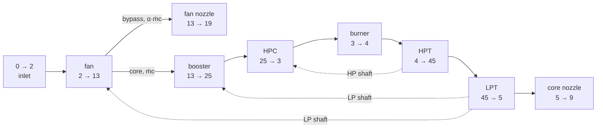
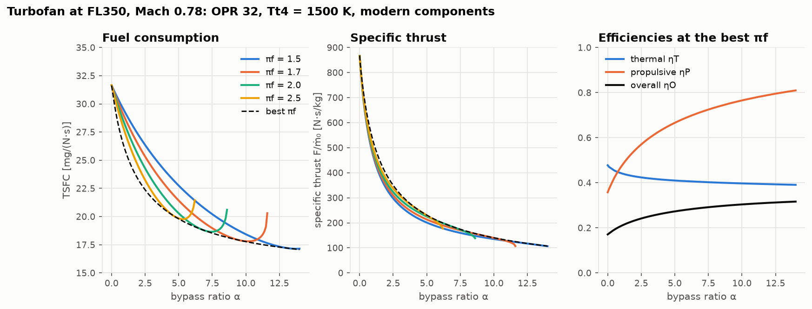
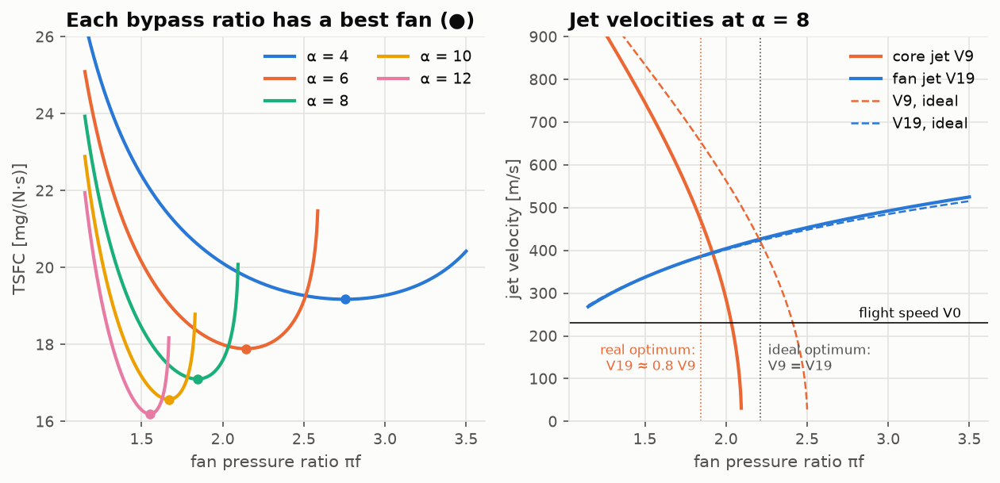

# Lesson 4 · The turbofan: moving more air, more slowly

> *Lesson 2 ended on a conflict. Thrust needs a jet faster than the aircraft, but every bit of
> extra jet speed is wasted energy. The turbofan's answer is to keep the hot core as a power
> source and spend its energy on a much larger stream of cold air. It is the single biggest
> fuel-saving idea in the history of jet propulsion.*

**Code:** [`src/propulsion/turbofan_model/`](../../src/propulsion/turbofan_model) ·
**Notebook:** [`04_turbofan.ipynb`](../../notebooks/04_turbofan.ipynb) ·
**Previous:** [Lesson 3 — Real components](03-real-components.md) ·
**Next:** [Lesson 5 — Off-design performance](05-off-design.md)

## Learning objectives

By the end of this lesson you should be able to

1. describe the two-spool, separate-exhaust turbofan and its station numbering;
2. write the power balance of each spool and the thrust of each stream;
3. explain, with the propulsive efficiency, why a turbofan uses less fuel than a turbojet with
   the same core;
4. derive the optimum fan pressure ratio (equal jet speeds) and the optimum bypass ratio of the
   ideal turbofan;
5. explain why the real optimum leaves the fan jet slower than the core jet.

---

## 1. The engine



A two-spool, separate-exhaust turbofan (the CFM56 and LEAP layout) has two shafts:
- the **high-pressure (HP) spool**: the HP turbine drives the HP compressor;
- the **low-pressure (LP) spool**: the LP turbine drives the fan and the booster (LP compressor)
  on a second, concentric shaft.

The fan stream splits after the fan. The **bypass ratio** α is the ratio of the air that goes
around the core to the air that goes through it:

```math
\alpha = \frac{\dot m_{bypass}}{\dot m_{core}}, \qquad \dot m_0 = (1 + \alpha)\,\dot m_{core}
```

The design variables are α, the fan pressure ratio $\pi_f$, the overall pressure ratio
$\pi_c = P_{t3}/P_{t2}$ (fan × booster × HPC, as the core sees it), the booster ratio $\pi_{cL}$, and
$T_{t4}$.

## 2. Spool balances

Per unit of core air flow, with fuel/air ratio f in the core:

```math
\text{HP spool:}\quad \eta_{m}(1 + f)\,c_{pt}(T_{t4} - T_{t45}) = c_{pc}(T_{t3} - T_{t25})
```

```math
\text{LP spool:}\quad \eta_{m}(1 + f)\,c_{pt}(T_{t45} - T_{t5}) = c_{pc}\left[(1 + \alpha)(T_{t13} - T_{t2}) + (T_{t25} - T_{t13})\right]
```

The LP turbine pays for the fan work on **all** $(1+\alpha)$ units of air. This is the energy
transfer at the heart of the turbofan: enthalpy taken out of the hot core gas, which would
otherwise leave as a fast jet, is put into a large stream of cold air.

## 3. Thrust from two streams

Each stream has its own nozzle (Lesson 3's `nozzle_exit`), and thrust is their sum. Per unit of
*total* inlet air:

```math
\frac{F}{\dot m_0} = \frac{1}{1 + \alpha}\left[\underbrace{(1+f)V_9 - V_0 + \ldots}_{\text{core}} + \alpha\underbrace{\left(V_{19} - V_0 + \ldots\right)}_{\text{bypass}}\right],
\qquad S = \frac{f}{(1 + \alpha)\,F/\dot m_0}
```

The "…" are the pressure-thrust terms of under-expanded nozzles. The fuel is burned only in the
core, so the engine's overall fuel/air ratio is $f/(1+\alpha)$.

## 4. Why it saves fuel

The thermal efficiency now counts the kinetic-energy gain of both streams:

```math
\eta_T = \frac{(1+f)V_9^2 + \alpha V_{19}^2 - (1+\alpha)V_0^2}{2 f h_{PR}}, \qquad
\eta_P = \frac{2(1+\alpha)V_0\,F/\dot m_0}{(1+f)V_9^2 + \alpha V_{19}^2 - (1+\alpha)V_0^2}
```

(As in Lesson 3, $V_9$ and $V_{19}$ in these energy terms are the fully expanded jet velocities.)

Keep the core fixed and raise α. The core produces roughly the same useful energy, so ηT barely
changes. But that energy now accelerates much more air to a much lower speed, so ηP climbs.



With the core fixed (OPR 32, $T_{t4}$ = 1500 K, modern components) at FL350, Mach 0.78:

| | α = 0 (turbojet) | α = 5.5 | α = 12 |
|---|---|---|---|
| best TSFC [mg/(N·s)] | 29.5 | 18.2 | 16.2 |
| specific thrust at that point [N·s/kg] | 865 | 216 | 121 |
| propulsive efficiency ηP | 0.36 | 0.68 | 0.79 |
| thermal efficiency ηT | 0.51 | 0.44 | 0.42 |
| share of thrust from the fan | 0 | 78 % | 87 % |

Going from turbojet to α = 12 **cuts fuel consumption by 45 %**. The price is a seven-fold drop
in specific thrust: for the same thrust, the engine must swallow seven times more air, so it has
a much bigger fan, nacelle and weight. Lesson 6 explores that trade.

The thermal efficiency *falls* slightly with α. Every unit of energy routed through the LP
turbine and fan picks up their losses on the way.

## 5. The ideal turbofan: two optima

With ideal components and one gas, the jet velocities have closed forms. Here $\tau_c$ is the
temperature ratio of the whole core compression:

```math
\left(\frac{V_9}{a_0}\right)^2 = \frac{2}{\gamma-1}\left[\tau_\lambda - \tau_r\left(\tau_c - 1 + \alpha(\tau_f - 1)\right) - \frac{\tau_\lambda}{\tau_r\tau_c}\right], \qquad
\left(\frac{V_{19}}{a_0}\right)^2 = \frac{2}{\gamma-1}\left(\tau_r\tau_f - 1\right)
```

The fuel flow f depends only on the core ($\tau_\lambda - \tau_r\tau_c$), not on α or $\pi_f$. So
minimum TSFC means **maximum thrust from a fixed amount of core energy**. Ask what a small change
does with that energy.

**Optimum fan pressure ratio (α fixed).** Raise $\pi_f$ a little. The LP turbine takes energy
dE from each kilogram of core gas and gives it to the α kilograms of bypass air. In an ideal
machine, kinetic energy is conserved in the transfer: $V_9\ dV_9 = -\alpha V_{19}\ dV_{19}$. The
thrust change is

```math
dF \propto dV_9 + \alpha\,dV_{19} = \alpha\,dV_{19}\left(1 - \frac{V_{19}}{V_9}\right)
```

which vanishes when the **two jets are equally fast**, $V_{19} = V_9$. Shifting energy is worth it
as long as it moves from the faster jet to the slower one. Solving $V_9 = V_{19}$ for $\tau_f$:

```math
\tau_f^{\ast} = \frac{\tau_\lambda - \tau_r(\tau_c - 1) - \tau_\lambda/(\tau_r\tau_c) + \alpha\tau_r + 1}{\tau_r(1 + \alpha)}
```

**Optimum bypass ratio ($\pi_f$ fixed).** Add a little bypass air dα. It leaves at the fixed
$V_{19}$, so it adds thrust $(V_{19} - V_0)\ d\alpha$. The core pays for its kinetic energy,
$\tfrac12(V_{19}^2 - V_0^2)\ d\alpha$, with a slower core jet. Setting the sum to zero gives

```math
V_9 - V_0 = \tfrac{1}{2}\left(V_{19} - V_0\right)
\quad\Longrightarrow\quad
\alpha^{\ast} = \frac{\tau_\lambda - \tau_r(\tau_c - 1) - \tau_\lambda/(\tau_r\tau_c) - \tfrac14\left(\sqrt{\tau_r\tau_f - 1} + \sqrt{\tau_r - 1}\right)^2}{\tau_r(\tau_f - 1)}
```

The tests run brute-force searches over 200,001 bypass ratios and 200,001 fan pressure ratios.
They recover both formulas, and both jet-velocity conditions to 10⁻⁹.

## 6. The real optimum: the fan jet is slower



With real components, energy moved from the core to the bypass stream loses something in the LP
turbine, the shaft and the fan. Repeat the argument with a transfer efficiency
$\eta_{tr} \approx \eta_{LPT}\ \eta_m\ \eta_f$: removing dE from the core costs $dE/V_9$ of core
thrust, and delivers only $\eta_{tr}\ dE/V_{19}$ of fan thrust. The optimum moves to

```math
\frac{V_{19}}{V_9} \approx \eta_{tr}
```

In the right-hand figure (α = 8), the ideal curves cross at $\pi_f$ = 2.21, with equal jets. The
real optimum is at $\pi_f$ ≈ 1.85, where $V_{19}/V_9$ ≈ 0.82. There $\eta_{tr}$ ≈ 0.88 × 0.91 × 0.99
≈ 0.80, so the estimate is close. It is not exact, because the optimum depends on the
efficiency of the *marginal* energy transferred, not on the machines' overall efficiencies.

Each bypass ratio has its own best fan (left figure). The higher α, the lower the optimum
$\pi_f$: 2.8 at α = 4, 1.55 at α = 12. **High bypass ratio and low fan pressure ratio go
together.** Their product sets the fan's job, and the available core energy is spread over more
air.

## 7. Worked example: a 5.5-bypass turbofan at cruise

FL350, Mach 0.78, standard day, `Components.modern()`. Design: α = 5.5, $\pi_f$ = 1.7, booster
$\pi_{cL}$ = 1.6, OPR $\pi_c$ = 32 (so the HPC ratio is 32/(1.7 × 1.6) = 11.76), $T_{t4}$ = 1450 K.
These are illustrative choices, not the data of any engine.

1. **Inlet and fan.** $T_{t2}$ = 245.4 K, $P_{t2}$ = 35.46 kPa. Fan: $T_{t13}$ = 291.0 K,
   $P_{t13}$ = 60.28 kPa.
2. **Core compression.** Booster: $T_{t25}$ = 337.8 K, 96.45 kPa. HPC: $T_{t3}$ = 738.9 K,
   $P_{t3}$ = 1135 kPa.
3. **Burner.** f = 0.02392 per kilogram of *core* air. $P_{t4}$ = 1089 kPa.
4. **HP turbine** (drives the HPC): $T_{t45}$ = 1129.4 K, πtH = 0.296.
5. **LP turbine** (drives fan and booster): $T_{t5}$ = 855.1 K, πtL = 0.258, $P_{t5}$ = 83.28 kPa.
6. **Jets.**
   - Fan nozzle: pressure ratio 2.50, $V_{19}$ = 367.1 m/s.
   - Core nozzle: pressure ratio 3.46, $V_9$ = 726.3 m/s.
   - The flight speed is $V_0$ = 231.2 m/s.
7. **Thrust.** $F/\dot m_0$ = 193.8 N·s/kg: 78.8 from the core and 115.0 from the fan (59 %).
8. **Fuel and efficiencies.** S = 18.99 mg/(N·s) = 0.670 lb/(lbf·h). ηT = 45.6 %, ηP = 62.4 %,
   ηO = 28.4 %.
9. **Engine size.** With $\dot m_0$ = 125 kg/s at cruise (about Lesson 1's fan face), thrust is
   24.2 kN and fuel flow 0.460 kg/s (1656 kg/h).

For comparison, a turbojet with the same core (OPR 32, 1450 K) gives 827 N·s/kg and
28.97 mg/(N·s). The fan saves **34 %** of the fuel.

This design is not optimal. At α = 5.5 the best fan pressure ratio is 2.14, giving 18.05 mg/(N·s)
(−5 %). That point has $V_{19}/V_9$ = 0.82. Real fans are often chosen below the TSFC optimum, for
fan-tip speed, noise and nozzle weight.

```python
from propulsion.component_models import Components
from propulsion.flight import FlightCondition
from propulsion.turbofan_model import turbofan
from propulsion.units import FT

fl350 = FlightCondition.at_altitude(35000 * FT, 0.78, geopotential=True)
p = turbofan(
    fl350, alpha=5.5, pi_f=1.7, pi_c=32.0, Tt4=1450.0, pi_cL=1.6, components=Components.modern()
)
p.specific_thrust, p.tsfc * 1e6  # 193.8 N s/kg, 18.99 mg/(N s)
p.extras["specific_thrust_core"], p.extras["specific_thrust_fan"]  # 78.8, 115.0
p.V9, p.extras["V19"]  # 726.3, 367.1 m/s
```

## 8. From equations to code

| Concept | Function |
|---|---|
| two-spool turbofan | `turbofan(flight, alpha, pi_f, pi_c, Tt4, pi_cL, components, core_nozzle, fan_nozzle)` |
| core / fan thrust, jet speeds | `extras["specific_thrust_core"]`, `["specific_thrust_fan"]`, `["V19"]`, `["thrust_ratio_fan"]` |
| spool temperature ratios | `extras["tau_tH"]`, `extras["tau_tL"]`, `extras["pi_cH"]` |
| ideal jet velocities | `ideal_jet_velocities(flight, alpha, pi_f, pi_c, Tt4)` |
| ideal optima | `optimum_bypass_ratio(flight, pi_f, pi_c, Tt4)`, `optimum_fan_pressure_ratio(flight, alpha, pi_c, Tt4)` |

The tests in [`tests/test_turbofan.py`](../../tests/test_turbofan.py) check:
- with α = 0 the turbofan reproduces Lesson 3's turbojet exactly, ideal or not;
- the ideal limit matches the closed forms;
- an ideal cycle gives the same result however the compression is split between booster and HPC;
- both spool power balances close;
- core plus fan thrust equals the total;
- bypass raises ηP and lowers TSFC.

## 9. Common pitfalls

- **Per core flow or per total flow?** f is per kilogram of core air; specific thrust is per
  kilogram of *total* air. Mixing them is the classic turbofan bug, and is why
  $S = f/((1+\alpha)F/\dot m_0)$.
- **The LP turbine drives (1+α) units of fan flow.** Forgetting the bypass air in the LP balance
  makes the fan "free".
- **Too high a fan pressure ratio for the bypass ratio.** The LP turbine takes so much energy that
  the core jet runs out ($V_9 \to 0$, the vertical walls in the figures). There is no thrust left
  from the core, and TSFC shoots up.
- **Overall pressure ratio is not the HPC ratio.** In this code `pi_c` is $P_{t3}/P_{t2}$, the
  whole core compression; the HPC alone does `pi_c / (pi_f * pi_cL)`.
- **"Higher bypass is always better."** For TSFC at cruise, nearly. For the aircraft, not: weight
  and nacelle drag grow with fan diameter (Lesson 6).

## 10. Exercises

1. An ideal turbofan (one gas, ideal components) flies at FL350, Mach 0.78, with α = 5,
   $\pi_f$ = 1.7, $\pi_c$ = 30 and $T_{t4}$ = 1600 K. Find $V_9$, $V_{19}$, specific thrust, TSFC,
   ηT and ηP.
2. For the same engine, find the optimum bypass ratio α*. Check that $V_9 - V_0 = (V_{19} - V_0)/2$
   there, and give TSFC and specific thrust.
3. Find the ideal optimum fan pressure ratio at α = 10 for the same core.
4. Derive the condition $V_{19} = V_9$ for the optimum fan pressure ratio of an ideal turbofan,
   starting from $F \propto (V_9 - V_0) + \alpha(V_{19} - V_0)$ and conservation of kinetic energy.
5. Give the worked example convergent core and fan nozzles. Check that both nozzles choke, and
   find the thrust and TSFC penalty. Compare with the convergent turbojet of Lesson 3.

<details>
<summary>Answers</summary>

1. $V_9$ = 957.1 m/s, $V_{19}$ = 366.3 m/s, $F/\dot m_0$ = 233.5 N·s/kg, S = 15.93 mg/(N·s),
   ηT = 66.3 % (= $1 - 1/(\tau_r\tau_c)$, unchanged by the fan), ηP = 51.2 %. The core jet is far
   faster than the fan jet, a sign that α = 5 is well below optimum.
2. α* = 15.25. There $V_9$ = 298.7 m/s and $V_{19}$ = 366.3 m/s:
   $V_9 - V_0$ = 67.5 = (366.3 − 231.2)/2 ✓. S = 10.50 mg/(N·s), but specific thrust is only
   130.9 N·s/kg.
3. $\pi_f^{\ast}$ = 2.085.
4. Ideal transfer: $\tfrac12 dV_9^2 = -\tfrac12\alpha\ dV_{19}^2$, i.e. $V_9 dV_9 = -\alpha V_{19} dV_{19}$.
   Then $dF \propto dV_9 + \alpha dV_{19} = \alpha dV_{19}(1 - V_{19}/V_9)$. This is zero for a
   non-trivial change only if $V_{19} = V_9$. For $V_{19} < V_9$, raising $\pi_f$ helps.
5. Fan nozzle pressure ratio 2.50 and core 3.46: both above the critical ratio (1.89 and 1.83),
   so both choke. Thrust falls 1.1 % (191.6 vs 193.8 N·s/kg) and TSFC rises to 19.21 mg/(N·s).
   The turbojet lost 10.6 %, because its nozzle pressure ratio was 10.

</details>

## Key takeaways

- A turbofan uses the core as a gas generator and spends its energy on a large, slow bypass
  stream. Propulsive efficiency rises from about 0.35 to about 0.8.
- The LP turbine–fan energy transfer is the defining feature. Per kilogram of total air,
  TSFC = f/((1+α)·F/ṁ0).
- Ideal optima: equal jet speeds (best fan) and $V_9 - V_0 = \frac12(V_{19} - V_0)$ (best bypass).
  With losses, the best fan jet is slower than the core jet by about the transfer efficiency.
- High bypass ratio, low fan pressure ratio and low specific thrust go together. They save fuel
  and cost size.

## Further reading

- J. D. Mattingly, *Elements of Propulsion*, 2nd ed., Ch. 5 (ideal turbofan) and Ch. 7 (real
  turbofan).
- H. I. H. Saravanamuttoo et al., *Gas Turbine Theory*, Ch. 3 (turbofan cycles).
- P. P. Walsh & P. Fletcher, *Gas Turbine Performance*.
