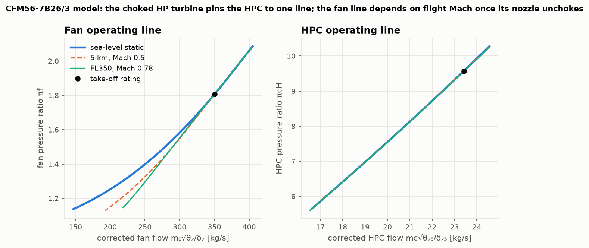
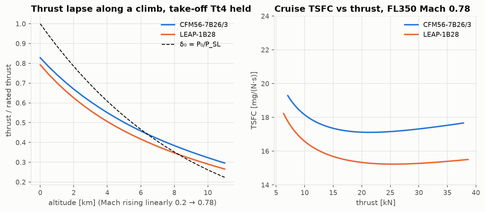

# Lesson 5 · Off-design: how an engine behaves in flight

> *A cycle analysis designs an engine for one moment. The engine then has to live through all
> the others: take-off on a hot day, climb, cruise, descent and idle at the gate. Its geometry
> is fixed and its pilot has one lever. What decides its pressure ratios, its spool speeds, its
> EGT and its fuel flow at each moment? And does the answer agree with real engines?*

**Code:** [`src/propulsion/off_design_performance/`](../../src/propulsion/off_design_performance),
[`validation/engines.py`](../../validation/engines.py) ·
**Notebook:** [`05_off_design.ipynb`](../../notebooks/05_off_design.ipynb) ·
**Previous:** [Lesson 4 — The turbofan](04-turbofan.md) ·
**Next:** [Lesson 6 — Trade studies](06-trade-studies.md)

## Learning objectives

By the end of this lesson you should be able to

1. explain the difference between design (cycle) analysis and off-design (performance) analysis;
2. derive why choked turbine nozzles fix the HP turbine's temperature ratio;
3. set up the matching problem (unknowns, constraints) and solve it with Newton's method and
   continuation;
4. use corrected parameters to move engine data between altitudes, speeds and temperatures;
5. read thrust, N1, N2, EGT and fuel flow trends from the model, and compare them with the ICAO
   databank and the EASA type-certificate data of the CFM56-7B and LEAP-1B.

---

## 1. From choices to consequences

In Lessons 2–4 the bypass ratio, the pressure ratios and $T_{t4}$ were **choices**. Once the
engine is built they are **consequences**. What is fixed now is the hardware:
- the throat areas of the HP turbine nozzle (station 4), the LP turbine nozzle (45), the core
  nozzle (9) and the fan nozzle (19);
- the quality of each component, which we keep at its design value (constant polytropic
  efficiencies and pressure-loss ratios: the standard first approximation, without maps);
- the fuel control. The only input left is the throttle, which we represent by $T_{t4}$.

`TurbofanEngine.design(...)` runs the Lesson 4 cycle once and stores those areas. From then on,
`engine.operate(flight, Tt4)` works out where the engine must run.

## 2. Why choked turbines simplify everything

The first stator of each turbine (the nozzle guide vanes) accelerates the gas to sonic speed
over most of the operating range. From Lesson 1, a choked throat passes a fixed corrected flow:

```math
\frac{\dot m_4\sqrt{T_{t4}}}{P_{t4}A_4} = \mathrm{MFP}(1), \qquad
\frac{\dot m_{45}\sqrt{T_{t45}}}{P_{t45}A_{45}} = \mathrm{MFP}(1)
```

The same gas flows through both, $\dot m_{45} = \dot m_4$. Divide the two:

```math
\frac{P_{t45}}{P_{t4}}\sqrt{\frac{T_{t4}}{T_{t45}}} = \frac{\pi_{tH}}{\sqrt{\tau_{tH}}} = \frac{A_4}{A_{45}} = \text{const}
```

With constant polytropic efficiency, $\pi_{tH}$ is a fixed function of $\tau_{tH}$, so both are
**constant**. The HP turbine always extracts the same *fraction* of the gas's enthalpy. Every
other relation in this lesson leans on that fact.

## 3. The matching problem

Four unknowns describe an off-design point: $\pi_f$, $\pi_{cL}$, $\pi_{cH}$ and α. Four physical
constraints pin them down:

| # | Constraint | Physics |
|---|---|---|
| 1 | $\tau_{tH} = \tau_{tH,design}$ | choked HPT and LPT nozzles (Section 2) |
| 2 | $(T_{t25} - T_{t13})/(T_{t13} - T_{t2})$ = design value | fan and booster share a shaft, so their work keeps its proportion |
| 3 | α = (flow the fan nozzle passes)/(flow the HPT passes) | $\dot m_c(1+f) = C_4 P_{t4}/\sqrt{T_{t4}}$ and $\dot m_b = A_{19}\mathrm{MFP}(M_{19})P_{t19}/\sqrt{T_{t13}}$ |
| 4 | the core gas fits through $A_9$ | $\dot m_c(1+f) = A_9\mathrm{MFP}(M_9)P_{t9}/\sqrt{T_{t5}}$ |

The HP spool balance and the LP spool balance are not on the list. Given the four unknowns, the
on-design function of Lesson 4 computes $T_{t45}$ and $T_{t5}$ from those balances, so they hold
automatically. That is also why the design point is reproduced *exactly*: at the design inputs
all four residuals are zero.

The solver works in logarithms of the unknowns, which keeps them positive, and uses SciPy's
Powell hybrid method (`scipy.optimize.root`, `method="hybr"`). Far from the design point a cold
start can fail, so `operate` falls back on **continuation**. It walks from a solved point to the
target in steps, blending flight condition and $T_{t4}$, and halves the step whenever a solve
fails. `operate_at_thrust` finds the throttle setting for a required thrust the same way: it
marches $T_{t4}$ until the thrust is bracketed, then uses Brent's method.

Two checks in [`tests/test_off_design.py`](../../tests/test_off_design.py) show the formulation
is right:
- The LP turbine nozzle (station 45) is never imposed as a constraint, yet its corrected flow
  stays constant to 10⁻⁸ at every operating point. That is Section 2 seen from the other side.
- Reaching the same point by two different continuation paths gives the same answer to 10⁻⁹.

## 4. Corrected parameters: one engine, every day

Lesson 1 introduced corrected flow. Dimensional analysis says more. An engine's
non-dimensional state depends on only two things: the flight Mach number $M_0$ and the
non-dimensional throttle $T_{t4}/T_0$. If those match, all the pressure ratios, the bypass ratio
and the corrected quantities match too:

```math
\frac{F}{\delta_0}, \qquad \frac{\dot m_0\sqrt{\theta_2}}{\delta_2}, \qquad \frac{N}{\sqrt{\theta_2}}, \qquad \frac{T_{t4}}{\theta_0}, \qquad \frac{\dot m_f}{\delta_2\sqrt{\theta_2}}
```

are the same at 3 km and at 9 km, on a cold day or a hot one. The test
`test_corrected_parameters_are_similar` checks this to 10⁻⁸, with the fuel mass neglected. The
fuel's heating value does not scale with temperature, so with $(1+f)$ included the similarity is
only approximate. This is how engine manufacturers reduce test-cell data, and how a flight crew's
tables can cover the whole envelope with a few curves.



The figure plots the CFM56-7B26/3 model's operating points in corrected coordinates, at three
flight conditions.
- **The HPC line is the same everywhere.** The choked HP turbine downstream pins it.
- **The fan line depends on flight Mach** wherever the fan nozzle is unchoked. At sea-level
  static it never chokes ($M_{19}$ = 0.95 even at take-off). At cruise it chokes down to low
  power, and the lines merge.

### Cruise is take-off, corrected

Run the model at FL350, Mach 0.78, at the 22 kN that cruise needs. The burner exit temperature
is only 1195 K, but $T_{t4}/\theta_0$ = 1574 K. The corrected fan speed is 100.5 % and the
corrected flow 352 kg/s, almost exactly the take-off values (100 %, 350 kg/s). In the engine's
own non-dimensional world, cruise and take-off are nearly the same operating point. The
**physical** spool speeds, temperatures and flows are lower only because the air is thin and
cold.

## 5. Throttle, spool speeds and EGT


Down the throttle line at sea-level static (middle and right panels):
- **N1 falls faster than N2.** The HP turbine sits between two choked throats, so its temperature
  ratio, and with it the HP spool's work per unit of gas, stays fixed. The LP turbine has no such
  anchor: downstream of it is a core nozzle that is unchoked at sea level, so as the nozzle
  pressure ratio falls the LPT expansion ratio collapses, and the fan work with it. Near idle the model has N1 ≈ 31 %
  and N2 ≈ 66 %, the familiar cockpit picture of a "high-idling" core.
- **The bypass ratio rises at part power** (5.1 → 6.4 at approach for the CFM56 model). The core
  shrinks faster than the fan stream.
- **Turbine temperatures fall with thrust.** The EASA data sheets say where the engines measure
  EGT. The CFM56-7B measures at T49.5, the second LP turbine nozzle, which lies between our
  stations 45 and 5. The LEAP-1B measures at T48, the LP turbine inlet: our $T_{t45}$.

Both models stay far below the take-off EGT limits of the data sheets (950 °C and 1038 °C). That
is expected rather than reassuring. With no cooling flows, the calibrated $T_{t4}$ is an
uncooled-equivalent temperature that sits well below a real combustor exit.

### Hot days and flat rating

On an ISA+15 day at the take-off $T_{t4}$, the model gives only 86.8 % of rated thrust. Hot air
means a lower corrected throttle $T_{t4}/\theta_0$. A standard day at $T_{t4}/\theta_0$ gives
86.6 %, which is similarity at work. To hold rated thrust on that hot day the control must raise
$T_{t4}$ by about 73 K (CFM56 model), and $T_{t45}$ rises by 56 K. EGT margin is eaten up on hot
days. This is why engines are **flat-rated**: they promise constant thrust only up to a corner
temperature.

### Lapse and the TSFC bucket



- **Thrust lapse.** Holding the take-off $T_{t4}$ along a climb, thrust falls roughly with the
  pressure ratio $\delta_0$, faster than δ0 near the ground (ram drag grows with speed) and
  slower at altitude (cold air raises $T_{t4}/\theta_0$). The higher-bypass LEAP-1B lapses
  faster. Its slow jet loses a larger share of its thrust to ram drag as speed rises.
- **The TSFC bucket.** At cruise, TSFC has a minimum around 20–25 kN. At higher thrust the jets
  are fast (low ηP). At lower thrust the cycle runs at low pressure ratio and temperature (low ηT).

## 6. Validation against the CFM56-7B and LEAP-1B

What real data says, and what the model has to assume:

| | Source | CFM56-7B26/3 | LEAP-1B28 |
|---|---|---|---|
| rated thrust | ICAO EEDB Issue 32 (UIDs 8CM065, 08P28CM143) | 117.0 kN | 130.4 kN |
| bypass ratio | ICAO EEDB | 5.1 | 8.24 |
| overall pressure ratio | ICAO EEDB | 27.7 | 42.03 |
| take-off fuel flow | ICAO EEDB | 1.213 kg/s | 1.070 kg/s |
| fan pressure ratio | **chosen**: minimum take-off TSFC | 1.81 | 1.52 |
| $T_{t4}$ | **calibrated** to take-off fuel flow | 1417 K | 1492 K |
| polytropic efficiencies, booster ratio | **assumed**, both engines | 0.92, 1.6 | 0.92, 1.6 |

Each engine has exactly **one** calibrated number. The other three ICAO fuel flows are
predictions:


| Mode (thrust) | CFM56-7B26/3 | LEAP-1B28 |
|---|---|---|
| climb-out (85 %) | +1.1 % | +0.9 % |
| approach (30 %) | −6.0 % | −6.1 % |
| idle (7 %) | −18.8 % | −21.1 % |

Two things stand out.
1. **Down to approach the trend is right within 6 %.** That is good for a model with constant
   component efficiencies and no maps.
2. **The errors are nearly identical for both engines.** A shared, systematic error points at the
   model, not the data. Near idle the real engine departs from our assumptions:
   - compressor and turbine efficiencies fall far from their design incidence;
   - the turbine nozzles unchoke;
   - the ICAO test includes power extraction and bleed that our model leaves out;
   - the burner runs very lean.
   All of these raise the real fuel flow. A model meant for idle needs component maps.

Finally, an honest failure from the history of this project. The first comparison could not
match the take-off fuel flow at *any* $T_{t4}$. That led to Lesson 3's burner-datum bug, an extra
≈ 70 kJ/kg of heat counted by the textbook two-gas energy balance. Real data does not just
confirm models; it finds their bugs.

At cruise, the model puts the LEAP-1B28's minimum TSFC 11 % below the CFM56-7B26/3's
(15.2 vs 17.1 mg/(N·s), 0.538 vs 0.604 lb/(lbf·h)). Lesson 6 takes that comparison apart.

## 7. Worked example: the CFM56 model at cruise

The calibrated CFM56-7B26/3 model at FL350, Mach 0.78, ISA, needing 22 kN of thrust:

1. **Throttle.** `operate_at_thrust` finds $T_{t4}$ = 1195 K, so $T_{t4}/\theta_0$ = 1574 K.
2. **Cycle.** πf = 1.818, overall πc = 27.2, α = 5.18. Both nozzles are choked.
3. **Flows.** $\dot m_0$ = 133.5 kg/s physical, 352.0 kg/s corrected.
4. **Speeds.** N1 = 92.8 % and N2 = 91.7 % of the take-off values. Corrected N1 = 100.5 %.
5. **Temperatures.** $T_{t45}$ = 647 °C, $T_{t5}$ = 360 °C.
6. **Fuel.** 0.377 kg/s (1356 kg/h). TSFC = 17.12 mg/(N·s) = 0.604 lb/(lbf·h).

```python
import sys

sys.path.insert(0, "validation")
from engines import calibrated_engine

from propulsion.flight import FlightCondition
from propulsion.units import FT

engine = calibrated_engine("CFM56-7B26/3")
fl350 = FlightCondition.at_altitude(35000 * FT, 0.78, geopotential=True)
p = engine.operate_at_thrust(fl350, 22e3)
p.Tt4, p.alpha, p.pi_c  # 1195 K, 5.18, 27.2
p.N1, p.N1_corrected, p.N2  # 0.928, 1.005, 0.917
p.fuel_flow, p.tsfc * 1e6  # 0.377 kg/s, 17.12 mg/(N s)
```

## 8. From equations to code

| Concept | Function |
|---|---|
| size an engine, freeze its geometry | `TurbofanEngine.design(flight, alpha, pi_f, pi_c, Tt4, pi_cL, thrust=...)` |
| operating point at a throttle setting | `engine.operate(flight, Tt4, guess=None)` → `OperatingPoint` |
| throttle for a required thrust | `engine.operate_at_thrust(flight, thrust)` |
| spool speeds, temperatures, corrected values | `OperatingPoint.N1`, `.N2`, `.Tt45`, `.Tt5`, `.corrected_flow`, `.N1_corrected` |
| calibrated real-engine models | `validation/engines.py`: `calibrated_engine("LEAP-1B28")` |
| cited data | `validation/reference_data/icao_eedb.csv`, `tcds.csv` |
| comparison and figures | `validation/engine_validation.py` → `validation/results/engine_validation.md` |

## 9. Common pitfalls

- **Re-optimising off design.** Off design nothing is chosen. If the bypass ratio does not
  change between take-off and cruise, the model is still doing cycle design.
- **Forgetting that nozzles unchoke.** A choked-everywhere model fixes the fan operating line and
  gets sea-level part power wrong. Use the MFP at the actual Mach number.
- **Comparing physical spool speeds across altitudes.** Compare N/√θ. A "100 % N1" at cruise is
  a very different aerodynamic state from 100 % at sea level.
- **Treating a calibrated value as a measurement.** Our $T_{t4}$ is a tuning knob that absorbs the
  missing cooling flows and every other modelling error. It is not the engine's true turbine
  temperature.
- **Trusting a model outside its assumptions.** Constant efficiencies are fine near the design
  line and wrong at idle (Section 6).

## 10. Exercises

1. Starting from the choked-flow relation at stations 4 and 45, show that $\pi_{tH}/\sqrt{\tau_{tH}}$
   is constant. Then use the polytropic relation to show $\tau_{tH}$ is constant.
2. A test cell at 1,500 m (P = 84.56 kPa, T = 278.4 K, static) measures 100 kN at some throttle.
   Using similarity, estimate the sea-level-static thrust at the same corrected throttle. What
   $T_{t4}$ should the sea-level run use, if the test used 1400 K?
3. Run the CFM56 model at sea-level static on an ISA+15 day at the take-off $T_{t4}$. What fraction
   of rated thrust do you get, and what $T_{t4}$ restores rated thrust? Explain with corrected
   parameters.
4. Using `engine_validation.md`, compare the N1 and N2 of the two models at approach. Why are they
   so similar, although the engines are very different?
5. List three physical effects, missing from the model, that make real idle fuel flow higher than
   predicted. For each, say whether it acts through component efficiency, mass flow or power.

<details>
<summary>Answers</summary>

1. $\dot m\sqrt{T_t}/(P_tA)$ = MFP(1) at both throats with the same $\dot m$, so
   $(P_{t45}/P_{t4})\sqrt{T_{t4}/T_{t45}} = A_4/A_{45}$. That is
   $\pi_{tH}\tau_{tH}^{-1/2}$ = const. With $\pi_{tH} = \tau_{tH}^{\gamma_t/((\gamma_t-1)e_t)}$ this
   becomes $\tau_{tH}^{n}$ = const with $n = \gamma_t/((\gamma_t-1)e_t) - \frac12 \neq 0$, so
   $\tau_{tH}$ is constant.
2. F/δ0 is preserved: δ0 = 84.56/101.325 = 0.8346, so the sea-level thrust is
   100/0.8346 = 119.8 kN. Keep $T_{t4}/\theta_0$: θ0 = 278.4/288.15 = 0.9662, so the sea-level run
   uses 1400/0.9662 = 1449 K. Exact similarity needs the same Mach number (here zero), and ignores
   the small effect of the fuel mass.
3. 86.8 % of rated thrust. Rated thrust needs $T_{t4}$ = 1490 K, 73 K more. The hot day lowers
   $T_{t4}/\theta_0$ from 1417 to 1347 K. A standard day at 1347 K gives 86.6 %, almost the same,
   because the engine responds to the corrected throttle.
4. N1 ≈ 58.7 % vs 58.4 % and N2 ≈ 80.9 % vs 81.2 %. Both are percentages of each engine's own
   take-off speed, and both models are run at the same *fraction* of rated thrust. The
   non-dimensional throttle response of two well-matched turbofans is similar. The physical rpm
   differ greatly.
5. (a) Component efficiencies fall far from design incidence (efficiency). (b) Customer bleed
   for cabin pressurisation and anti-ice takes compressed air out of the core (mass flow).
   (c) Generator and hydraulic pump loads on the HP spool (power). Others: turbine nozzles
   unchoke, cooling flows become a larger fraction, and the combustor runs less efficiently.

</details>

## Key takeaways

- Off design, the geometry decides. Four flow-matching and work constraints replace the four
  design choices.
- Choked turbines fix $\tau_{tH}$, which makes the problem tractable. Continuation makes it robust.
- Corrected parameters collapse an engine's behaviour onto one set of curves. Cruise is close to
  take-off in corrected terms.
- Calibrated on one take-off fuel flow, the model predicts the ICAO climb-out and approach fuel
  flows of two real engines within 1–6 %. It underpredicts idle by about 20 %, an honest map of
  where constant-efficiency modelling ends.

## Further reading

- J. D. Mattingly, *Elements of Propulsion*, 2nd ed., Ch. 8 (engine performance analysis).
- P. P. Walsh & P. Fletcher, *Gas Turbine Performance* (off-design matching, corrected
  parameters, ratings).
- H. I. H. Saravanamuttoo et al., *Gas Turbine Theory* (off-design performance).
- ICAO Annex 16, Volume II (emissions certification and the LTO cycle); EASA TCDS E.004 and E.115.
