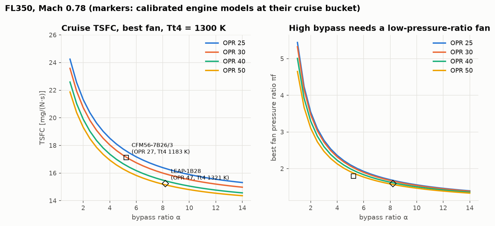
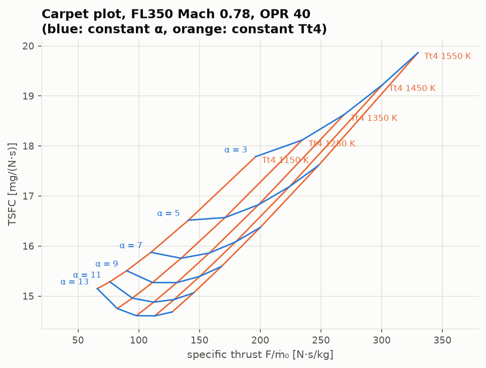
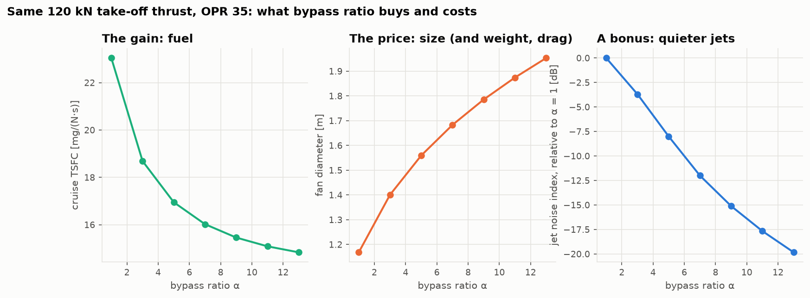
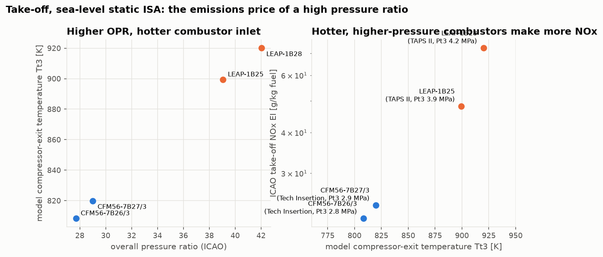

# Lesson 6 · Trade studies: why the LEAP-1B has a bigger fan

> *Every engine is a compromise. A bigger fan saves fuel but weighs more, drags more and has to
> fit under a wing. A higher pressure ratio saves fuel but runs the combustor hotter and makes
> more NOx. A hotter turbine buys thrust at the cost of materials. A designer cannot read the
> answer off one equation. We sweep the design space and look at the trade.*

**Code:** [`src/propulsion/trade_studies/`](../../src/propulsion/trade_studies),
[`validation/trade_studies.py`](../../validation/trade_studies.py) ·
**Notebook:** [`06_trade_studies.ipynb`](../../notebooks/06_trade_studies.ipynb) ·
**Previous:** [Lesson 5 — Off-design](05-off-design.md) ·
**Next:** [Lesson 7 — Verification and validation](07-verification-and-validation.md)

## Learning objectives

By the end of this lesson you should be able to

1. set up a cycle trade study with the right independent variables, and explain why the fan
   pressure ratio is optimised rather than swept;
2. read a carpet plot and find the best design for a required specific thrust;
3. quantify the classical trend toward high bypass ratio, and its diminishing returns;
4. put a price on bypass ratio: fan diameter, weight, jet noise;
5. explain the move from the CFM56-7B to the LEAP-1B, and the NOx cost of a high pressure ratio,
   with published data.

---

## 1. The design space

Lesson 4's cycle has four main knobs: bypass ratio α, fan pressure ratio $\pi_f$, overall
pressure ratio OPR = $\pi_c$, and turbine entry temperature $T_{t4}$. They are not equal partners.
For a given core (OPR, $T_{t4}$) and bypass ratio, Lesson 4 showed there is a **best fan
pressure ratio**: the one that moves energy from core to bypass until the marginal transfer stops
paying. Any other fan simply wastes fuel. So a fair comparison gives every (α, OPR, $T_{t4}$) its
own best fan, and sweeps the other three.

`best_fan_pressure_ratio(flight, alpha, pi_c, Tt4)` finds it in two steps:
1. a grid search, which is needed because past the optimum the core runs out of energy and TSFC
   becomes undefined (the cliffs in Lesson 4's figures);
2. a bounded refinement around the best grid point.

In the ideal limit it reproduces the closed form $\tau_f^{\ast}$ of Lesson 4 to 10⁻⁶ (a test).
`sweep(flight, alpha, pi_c, Tt4)` evaluates a whole grid.

Every study below uses the same component assumptions as the engine models of Lesson 5. They
are cycle comparisons: the technology is held fixed while the cycle changes.

## 2. Fuel: the classical trend



At FL350, Mach 0.78, with $T_{t4}$ = 1300 K:
- **TSFC falls with bypass ratio at every pressure ratio.** For a 120 kN-class engine (Section 4
  table), going from α = 1 to 5 cuts cruise TSFC by 26 %. Going from 5 to 13 cuts only a further
  12.5 %. Most of the propulsive-efficiency gain comes early, so the returns diminish.
- **TSFC falls with pressure ratio**, by a roughly constant step per curve. That is thermal
  efficiency working in parallel with the propulsive gains.
- **The best fan gets gentler as α rises**: above 4 at α = 1, 1.8 at α = 5, 1.3 at α = 13
  (take-off values from the Section 4 table). A
  high-bypass engine is a big, slow, low-pressure-ratio fan.

The calibrated models of Lesson 5, plotted at their cruise buckets, sit right on this map. The
CFM56-7B26/3 is at α = 5.2 with cruise OPR 27, slightly below its take-off 27.7. The LEAP-1B28
is at α = 8.2 with cruise OPR 47, above its take-off 42.0. Where an engine sits relative to its
take-off point depends on how hard its cruise bucket makes it work; the cold air at altitude
raises corrected speed.

## 3. The carpet plot



A carpet plot shows two design variables at once (here α and $T_{t4}$, at OPR 40), on the two
axes that matter: **specific thrust** (engine size per unit of thrust) and **TSFC** (fuel).
- Along a blue line (fixed α), raising $T_{t4}$ moves the design right: more specific thrust,
  since more energy goes into each kilogram of air. At low α TSFC rises (faster, more wasteful
  jets). At high α TSFC first falls, then rises.
- At **high α and low $T_{t4}$** the carpet folds back. The core is too weak to drive the big fan
  efficiently, and its own jet is starved. A high-bypass engine *needs* a hot core.
- The **lower envelope** of the carpet is the best design for each specific thrust. It runs
  toward high α *and* high $T_{t4}$ together. This is the historical path of engine design:
  turbine-temperature and bypass-ratio increases arrive as a pair.

## 4. The price of bypass



Hold the take-off thrust at 120 kN, OPR at 35 and $T_{t4}$ at 1450 K, and vary α:

| α | best πf | airflow [kg/s] | fan diameter [m] | jet noise index [dB] | cruise TSFC [mg/(N·s)] |
|---|---|---|---|---|---|
| 1 | 4.13 | 198 | 1.17 | 0 | 23.04 |
| 5 | 1.83 | 353 | 1.56 | −8.0 | 16.95 |
| 9 | 1.46 | 463 | 1.79 | −15.1 | 15.46 |
| 13 | 1.32 | 554 | 1.95 | −19.8 | 14.83 |

- **Size.** Lower specific thrust means more airflow for the same thrust. The annulus area
  follows the flow, so the fan diameter grows as $\sqrt{\dot m}$:
  $D = \sqrt{4\dot m\sqrt{T_{t2}}/(\pi P_{t2}\mathrm{MFP}(M_2)(1 - h^2))}$, with fan-face Mach 0.6
  and hub/tip ratio h = 0.3 assumed. Nacelle drag and weight grow faster than the diameter, and
  an under-wing engine also needs ground clearance. All of these push back on α.
- **Jet noise.** Lighthill's eighth-power law says a jet radiates acoustic power proportional to
  $\rho A V^8$, i.e. $\dot m V^7$. At fixed thrust the jets slow down as α rises, and the index
  drops 20 dB over this range. This is a ranking proxy, not a prediction: fan and turbine noise
  grow in relative importance as jets get quieter.

The EASA data sheets show the price paid in practice. The LEAP-1B has a dry weight not
exceeding 2780 kg against the CFM56-7B "TI" models' 2386 kg (+16.5 %), and a length of 3147 mm
against 2508 mm (+25 %) (TCDS E.115 Issue 09; E.004 Issue 07). The size proxy puts the two
calibrated models' fans at 1.55 m and 1.81 m. Fan diameters are not in the data sheets or the
ICAO databank, so this proxy is not validated here.

## 5. From CFM56-7B to LEAP-1B, one change at a time

Start from the CFM56-7B26/3 model's cruise cycle and change one design feature at a time until it
becomes the LEAP-1B28's (FL350, Mach 0.78, same component technology):

| step | α | πf | OPR | Tt4 [K] | TSFC [mg/(N·s)] | change |
|---|---|---|---|---|---|---|
| CFM56-7B26/3 cruise cycle | 5.24 | 1.80 | 26.6 | 1183 | 17.12 | |
| + LEAP overall pressure ratio | 5.24 | 1.80 | 46.7 | 1183 | 16.66 | −2.7 % |
| + LEAP turbine temperature | 5.24 | 1.80 | 46.7 | 1321 | 16.47 | −1.1 % |
| + LEAP fan (α and πf) | 8.20 | 1.59 | 46.7 | 1321 | 15.23 | −7.5 % |

In this model **the bigger fan is the largest single gain** (−7.5 % of the −11.0 % total). The
order is forced: a fan that big cannot be driven by the CFM56's cooler, lower-pressure core (the
cycle fails if you try). That is the carpet plot's lesson again: bypass ratio and core
temperature come together.

Two cautions:
- The split between steps depends on their order. The total does not.
- The model holds component efficiencies fixed. Part of the real LEAP-1B's advantage comes from
  better turbomachinery, materials and cooling, which a cycle-only comparison cannot see. This
  11 % is the part the *cycle* explains.

## 6. The emissions price of pressure ratio



Thermal NOx forms in the hottest parts of the flame, and its rate rises steeply with
temperature. A higher pressure ratio makes the air entering the combustor hotter and denser, so
the flame burns hotter. The ICAO databank shows the effect clearly in our four engines:

| Engine | ICAO OPR | model take-off $T_{t3}$ [K] | ICAO take-off NOx EI [g/kg] | combustor |
|---|---|---|---|---|
| CFM56-7B26/3 | 27.7 | 808 | 21.8 | single annular, "Tech Insertion" |
| CFM56-7B27/3 | 29.0 | 820 | 23.9 | single annular, "Tech Insertion" |
| LEAP-1B25 | 39.1 | 899 | 48.2 | TAPS II (staged lean burn) |
| LEAP-1B28 | 42.0 | 920 | 72.7 | TAPS II (staged lean burn) |

The LEAP's staged lean-burn combustor (TAPS II) is a low-NOx design. Even so, at take-off
($T_{t3}$ ≈ 900–920 K) it emits 2–3 times the NOx per kilogram of fuel of the CFM56. The two LEAP
ratings share one piece of hardware and differ only in rating: 21 K of extra combustor inlet
temperature takes NOx from 48 to 73 g/kg. The cycle sets the conditions; combustor technology
can only fight them.

This is why engine design is a three-way negotiation between fuel (CO₂), NOx and noise, under
ICAO standards that tighten each of them.

## 7. Worked example: a next-generation cycle

Suppose a designer pushes further: α = 12, OPR 50, cruise $T_{t4}$ = 1350 K, same component
technology.

1. **Cruise** (FL350, Mach 0.78). The best fan has πf = 1.44. TSFC is 14.46 mg/(N·s): −5.1 %
   against the LEAP-1B28 model and −15.5 % against the CFM56-7B26/3 model. Specific thrust is
   only 99.5 N·s/kg.
2. **Size.** For the LEAP-1B28's 130.4 kN at take-off ($T_{t4}$ = 1550 K), the best fan needs
   554 kg/s of air and a 1.95 m fan, against 1.81 m for the LEAP model.
3. **Emissions.** The take-off compressor exit reaches 971 K, 51 K hotter than the LEAP-1B28.
   On the trend of Section 6 that means a steep NOx rise, unless the combustor improves too.

```python
from propulsion.component_models import Components
from propulsion.flight import FlightCondition
from propulsion.trade_studies import fan_diameter, sweep
from propulsion.units import FT

# the assumptions of the validation studies (validation/engines.py)
kw = {
    "components": Components.modern().with_(e_f=0.92, e_c=0.92, e_t=0.92),
    "core_nozzle": "convergent",
    "fan_nozzle": "convergent",
    "pi_cL": 1.6,
    "pi_f_max": 10.0,
}
fl350 = FlightCondition.at_altitude(35000 * FT, 0.78, geopotential=True)
sls = FlightCondition.sea_level_static()
cruise = sweep(fl350, alpha=12.0, pi_c=50.0, Tt4=1350.0, **kw)
cruise.pi_f.item(), cruise.tsfc.item() * 1e6  # 1.44, 14.46 mg/(N s)
takeoff = sweep(sls, alpha=12.0, pi_c=50.0, Tt4=1550.0, **kw)
mdot = 130.41e3 / takeoff.specific_thrust.item()  # 554 kg/s
fan_diameter(mdot, sls), takeoff.Tt3.item()  # 1.95 m, 971 K
```

## 8. From equations to code

| Concept | Function |
|---|---|
| best fan for a core | `best_fan_pressure_ratio(flight, alpha, pi_c, Tt4, pi_cL, pi_f_max)` |
| grid sweep (each point with its best fan) | `sweep(flight, alpha, pi_c, Tt4, ...)` → `Sweep` |
| fan diameter from airflow | `fan_diameter(mdot0, flight, M2=0.6, hub_tip=0.3)` |
| jet-noise ranking | `jet_noise_index(perf, thrust)` |
| studies, tables and figures | `validation/trade_studies.py` → `validation/results/trade_studies.md` |

## 9. Common pitfalls

- **Sweeping α at a fixed fan pressure ratio.** At a fixed πf, high α simply starves the core
  (Lesson 4's cliffs) and the trend looks wrong. Give every design its best fan.
- **Comparing designs at different specific thrust as if they were the same engine.** A lower
  TSFC at half the specific thrust needs twice the airflow. Always look at both axes (carpet).
- **Taking a proxy for a prediction.** The jet-noise index and the fan diameter rank designs.
  They do not certify an aircraft.
- **Crediting the cycle with technology.** A cycle study holds efficiencies fixed. Real
  generational gains combine cycle and technology.
- **Forgetting emissions.** A cycle optimised for fuel alone drifts toward high $T_{t3}$, which is
  exactly what NOx regulation pushes against.

## 10. Exercises

1. Repeat the worked example with `Components.modern()` (polytropic efficiencies 0.89–0.90)
   instead of 0.92. How much do cruise TSFC and the best fan change, and why?
2. From the Section 4 table, compute the cruise TSFC change from α = 5 to 9 and from 9 to 13.
   What does this say about the benefit of going past α ≈ 12?
3. Show that for one jet at fixed static thrust, $\dot m V^7 \propto F V^6$. By how many decibels
   does halving the jet velocity lower the index?
4. On the carpet at OPR 40, which combination of α and $T_{t4}$ (within the plotted ranges)
   gives the lowest TSFC at a specific thrust of about 150 N·s/kg?
5. The LEAP-1B25 and LEAP-1B28 are the same hardware at different ratings. Use the ICAO data and
   the model's $T_{t3}$ to explain why their take-off NOx emission indices differ by 50 %.

<details>
<summary>Answers</summary>

1. Cruise TSFC rises from 14.46 to 15.84 mg/(N·s) (+9.5 %), and the best fan pressure ratio
   falls from 1.44 to 1.36. Poorer turbomachinery hurts twice. The core itself is less efficient
   (lower ηT). The LP turbine–fan energy transfer is also less efficient, so by Lesson 4's rule
   ($V_{19}/V_9 \approx \eta_{tr}$) it pays to transfer less energy, hence a gentler fan. A
   2-point change in polytropic efficiency matters as much as a large change in bypass ratio.
2. α 5 → 9: 16.95 → 15.46, −8.8 %. α 9 → 13: 15.46 → 14.83, −4.1 %. Each step buys less, while
   the fan diameter keeps growing (1.56 → 1.79 → 1.95 m). Somewhere around α ≈ 12–15, weight,
   nacelle drag and installation cost more than the TSFC gain at aircraft level.
3. Static: F = ṁV, so ṁV⁷ = (F/V)V⁷ = FV⁶. Halving V changes the index by
   10 log10(2⁻⁶) = −18.1 dB.
4. The lower envelope runs toward the highest temperature: α ≈ 11 with $T_{t4}$ = 1550 K gives
   145 N·s/kg at 15.06 mg/(N·s). For a given specific thrust, the best design uses the hottest
   turbine and the largest bypass ratio that together give that specific thrust.
5. Higher rating means higher take-off pressure ratio (39.1 vs 42.0 in the databank), hence a
   hotter combustor inlet (899 vs 920 K in the model). Thermal NOx rises steeply with flame
   temperature, roughly exponentially, so 21 K at the combustor inlet is enough to raise the EI
   from 48 to 73 g/kg.

</details>

## Key takeaways

- Trade studies sweep bypass ratio, pressure ratio and turbine temperature, each point with its
  best fan.
- TSFC falls with bypass ratio, with diminishing returns. Bypass ratio and core temperature must
  rise together (the carpet's lower envelope).
- Bypass ratio costs size and weight (the LEAP-1B is 16.5 % heavier than the CFM56-7B) and buys
  quieter jets.
- In this model, CFM56-7B → LEAP-1B is −11 % TSFC from the cycle alone, mostly from the bigger
  fan. The higher pressure ratio pays for its share with a hotter combustor and, per the ICAO
  databank, 3× the take-off NOx.

## Further reading

- J. D. Mattingly, *Elements of Propulsion*, 2nd ed., Ch. 5 and 7 (parametric studies and carpet
  plots).
- P. P. Walsh & P. Fletcher, *Gas Turbine Performance* (cycle design-point selection).
- M. J. Lighthill, "On sound generated aerodynamically. I. General theory", *Proc. R. Soc. A*
  211 (1952).
- ICAO Annex 16, Volume II (engine emissions standards); EASA TCDS E.004 and E.115.
