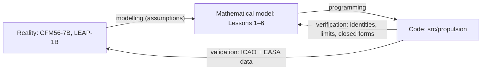

# Lesson 7 · Verification and validation

> *A model that produces numbers is easy to build. A model whose numbers you can trust is not.
> This lesson looks back at the whole course and asks two questions: did we solve the equations
> right, and did we solve the right equations? Then it tells the story of the bugs that real
> engine data found.*

**Code:** [`tests/`](../../tests), [`validation/`](../../validation) ·
**Report:** [validation report](../validation-report.md) ·
**Previous:** [Lesson 6 — Trade studies](06-trade-studies.md) ·
**Course index:** [README](README.md)

## Learning objectives

By the end of this lesson you should be able to

1. tell verification from validation, and give an example of each from this project;
2. design a test hierarchy for an engineering model: identities, limits, conservation,
   closed forms, similarity and data;
3. keep data, assumptions, calibration and prediction apart, and say which is which;
4. read a validation result honestly: when an error is a model limitation and when it is a bug;
5. make a computational project reproducible.

---

## 1. Two different questions

- **Verification**: *are we solving the equations right?* This is mathematics and software. The
  code should do exactly what the model says, to round-off.
- **Validation**: *are we solving the right equations?* This is physics. The model should
  reproduce reality well enough for its purpose.



Verification comes first. If the code does not solve its own equations, comparing it with data
only measures bugs. Here, `tests/` is mostly verification and `validation/` is mostly
validation. The [validation report](../validation-report.md) keeps the two apart.

## 2. A hierarchy of verification checks

A cycle model has no "exact solution" to compare against the way a heat-conduction code might.
Instead we used six kinds of check, from strongest to weakest.

| Kind | What it checks | Examples in this project |
|---|---|---|
| **Exact identities** | relations the model must satisfy for any input | $\eta_T = 1 - 1/(\tau_r\tau_c)$ equals KE gain / fuel energy; turbine work = compressor work; core + fan thrust = total |
| **Limits** | a general model collapsing to a simpler one | real turbojet with ideal components = ideal turbojet (to 6e-16); turbofan with α = 0 = turbojet; one gas → burner datum cancels |
| **Conservation and the second law** | energy and entropy | entropy rises through every lossy component; spool power balances close |
| **Closed forms vs brute force** | an analytical optimum against a dumb search | optimum πc, α* and πf* found by 200,000–400,000-point grids |
| **Symmetry and similarity** | invariances of the physics | corrected similarity across altitudes (2e-15); path independence of the solver |
| **Published tables** | independent computation of the same thing | US 1976 atmosphere; Anderson's isentropic tables; NIST units |

Two design choices made these checks possible.

1. **Build general models so that they contain the simple ones.** The non-ideal turbojet has
   switches (`Components()`, `hot=AIR`, `include_fuel_mass=False`) that turn it back into Lesson 2,
   so Lesson 2's closed forms test Lesson 3's code. The turbofan with α = 0 is a turbojet, so
   Lesson 3 tests Lesson 4.
2. **Reuse instead of re-implement.** The off-design solver does not re-derive the cycle. It
   calls the on-design `turbofan` function, so the design point is reproduced *by construction*,
   and every on-design test also covers off-design.

A third trick: check something you did **not** impose. The off-design solver imposes HP-turbine
choking. The LP-turbine nozzle's corrected flow is never imposed, yet the test finds it constant
to 10⁻⁸ at every operating point. A consequence you didn't program is strong evidence that the
model hangs together.

## 3. Validation: data, assumptions, calibration, prediction

Every number in a validated model belongs to exactly one of four classes. Mixing them up is the
most common way validation becomes self-deception.

| Class | Meaning | In the engine models of Lesson 5 |
|---|---|---|
| **Data** | measured or certified, cited | ICAO bypass ratio, OPR, rated thrust, LTO fuel flows, NOx; TCDS ratings, EGT stations, weights |
| **Assumption** | chosen, labelled, not tuned | polytropic efficiencies 0.92, booster ratio 1.6, gas properties, convergent nozzles |
| **Calibration** | tuned to one piece of data | $T_{t4}$, so that take-off fuel flow matches ICAO (one number per engine) |
| **Prediction** | everything else | climb-out, approach and idle fuel flows, N1, N2, lapse, hot-day, NOx trend |

Rules that keep this honest:
- **Cite every data value** (document, issue, table or databank UID) in the file that holds it.
  Values that cannot be checked against a source stay out. Fan diameters were left out: only
  third-party sites published them.
- **Calibrate as little as possible, and say so.** One calibration per engine, on the best-
  defined point (take-off). The other three LTO points then test the model.
- **Never re-tune to hide a bad prediction.** The idle error stays at about −20 % in the report,
  with its physical explanation.
- **Compare like with like.** The model's $T_{t4}$ is uncooled-equivalent, so its absolute EGT is
  not compared with the TCDS limits as if it were a validation.

## 4. Case study: the bug that real data found

When the CFM56-7B26/3 model was first compared with the ICAO databank, the plan was simple:
choose a fan, then adjust $T_{t4}$ until the take-off fuel flow matched. It could not be done.
Even at an implausibly low 1300 K, with good components, the model burned 5–10 % too much fuel.
The LEAP-1B28 showed the same.

A sweep over component efficiency ruled out "the components are too pessimistic" as the whole
story. The next suspect was the gas model, and the burner balance from Lesson 3:

```math
(1 + f)\,c_{pt}T_{t4} - c_{pc}T_{t3} = \eta_b h_{PR} f
```

This measures each gas's enthalpy from 0 K. Since $c_{pt} \neq c_{pc}$, the two gases do not share
a datum. The heating value $h_{PR}$ is defined at 298.15 K, so the balance silently counts
$(c_{pt} - c_{pc}) \times 298$ K ≈ 70 kJ/kg of heat that does not exist. Measuring both enthalpies
from 298.15 K fixed it. With plausible components, the calibration then landed at a physical
$T_{t4}$, and the climb-out prediction came out within 1 %.

Lessons from it:
- **A textbook formula can be wrong for your use.** The two-gas balance is fine as a teaching
  approximation and wrong at the 6–10 % level once you compare with data.
- **The failure mode was informative.** "No parameter value can match" is a much stronger signal
  than "the match is a bit off". It pointed at structure, not tuning.
- **The fix had its own test.** One gas, or `T_ref=0`, reproduces the textbook form exactly.
- **The lessons were updated**, numbers and all, rather than footnoted.

## 5. The six mistakes this project caught, and how

| # | Mistake | Caught by | Fix |
|---|---|---|---|
| 1 | ICAO's printed gas constant missed the US 1976 tables in the 7th digit | published table | use R*/M0 = 287.0531 |
| 2 | TSFC went negative past the zero-thrust pressure ratio | plotting a sweep (Lesson 3) | TSFC undefined (NaN) without thrust |
| 3 | "ideal" components still applied supersonic inlet shock losses | exact-limit test at Mach 2 | shock losses became a component property |
| 4 | burner enthalpies had no common datum | **real data** (ICAO take-off fuel flow) | measure from 298.15 K |
| 5 | propulsive efficiency above 1 with convergent nozzles | a sanity bound during the trade studies | jet power from fully expanded velocities |
| 6 | the HPT choking constraint assumed constant turbine efficiency | building the degradation study | impose $\pi_{tH}/\sqrt{\tau_{tH}}$ = const directly |

Only one of the six was found by data. The rest were found by checks that cost almost nothing:
an exact limit, a physical bound ($0 < \eta_P < 1$), a careful look at a plot. Cheap verification
catches most bugs. Validation catches the ones verification cannot see, because they live in the
equations, not in the code.

## 6. Reproducibility

A result nobody can regenerate is an anecdote. This project makes every output reproducible:
- **Pinned environment**: `uv.lock`, with CI on Python 3.11 and 3.12 running ruff and pytest on
  every push.
- **Generated, not hand-edited**: figures come from `validation/*.py` and
  `docs/lessons/make_figures.py`; notebooks from `notebooks/build_notebooks.py`; results tables
  from the validation scripts.
- **Byte-identical rebuilds**: PNGs carry no timestamp, notebook cells have stable ids, and
  output streams are merged. Rebuilding produces no git diff, so a diff always means something
  changed.
- **Docs as code**: `tests/test_docs.py` fails if inline math uses constructs that GitHub's
  renderer corrupts, and every Python snippet in the lessons is executed before it is committed.

## 7. Where this model ends

Validation tells you where to trust a model, and where not to. Do not use it for:
- **idle and very low power**: constant component efficiencies, choked turbines and no bleed are
  all wrong there (−20 % fuel flow);
- **absolute turbine temperatures and EGT margins**: no cooling flows, calibrated $T_{t4}$;
- **transients**: everything here is steady state (no spool inertia, no heat soak);
- **installation effects**: nacelle drag, inlet distortion, bleed and power offtakes;
- **component maps**: efficiency does not move with incidence or speed;
- **high temperatures, precisely**: constant cp and γ per section, no dissociation.

Each of these is a natural extension, and each would need its own verification and validation.

## 8. Worked example: planning V&V for a new feature

Suppose we add a **mixed-flow turbofan**, where core and bypass streams mix before one nozzle.
Before writing code, list the checks:
1. **Limit**: with α = 0 it must equal the turbojet; with ideal, isentropic mixing, the mixed
   stream's $T_t$ must be the mass-weighted enthalpy average.
2. **Conservation**: mass, momentum and energy across the mixer (three equations to check, not
   just impose); entropy must rise in mixing.
3. **Closed form**: the ideal mixed turbofan's specific thrust (Mattingly, Ch. 5) in the ideal
   limit.
4. **Comparison with the separate-exhaust engine**: same core, so the mixed engine should
   differ only by the mixing gain or loss, a small number with a known sign.
5. **Data**: a mixed-flow engine in the ICAO databank, calibrated once at take-off, predicting the
   other LTO points. Report the residuals whatever they are.

## 9. Exercises

1. Classify each check as verification or validation: (a) ISA vs the US 1976 tables;
   (b) α* closed form vs brute force; (c) climb-out fuel flow vs ICAO; (d) entropy rising in the
   compressor; (e) the NOx trend vs model $T_{t3}$.
2. Why calibrate $T_{t4}$ on take-off fuel flow rather than fitting it to all four LTO points?
3. The α = 0 turbofan test compares against the turbojet with `e_f` set equal to `e_c`. Why is
   that needed, and what bug would it catch?
4. The idle fuel flow is about 20 % low. Propose the single most promising model addition, and
   describe how you would verify it and then validate it.
5. A collaborator raises all polytropic efficiencies until the idle error vanishes. What is wrong
   with that, and what would you check first?

<details>
<summary>Answers</summary>

1. (a) Validation against a definition-based table. Strictly it verifies an implementation of
   the standard, since the ISA is a definition, not a measurement. (b) Verification.
   (c) Validation. (d) Verification (a second-law consistency check). (e) Validation, at trend
   level: the data are measured NOx, and the model supplies the explanatory variable.
2. Take-off is the best-defined point: rated thrust, choked nozzles, design incidence. Fitting all
   four would spend every data point on calibration and leave nothing to predict. The model would
   then match perfectly and be validated by nothing. One calibration and three predictions is a
   real test.
3. With α = 0 the "fan" is just the first part of the core's compression. If it had a different
   polytropic efficiency from the rest, the turbofan would correctly differ from a turbojet built
   with one efficiency. Setting `e_f = e_c` makes the two models physically identical, so any
   difference is a bug. Examples: a wrong booster temperature, LP work counted on the bypass
   flow, or a mislabelled station.
4. Component maps, or at least efficiency falling with corrected speed, are the main physics at
   idle. Customer bleed and power extraction are simpler to add. To verify: with zero bleed and
   power the model must reproduce the current results exactly, and the bleed's energy and mass
   must be conserved. To validate: the ICAO databank records loads and bleed conditions per test.
   Calibrate nothing new, and see whether approach and idle errors shrink while climb-out stays
   good.
5. It tunes a physically meaningful parameter to hide a structural problem. Higher efficiencies
   would also change take-off and climb-out, which would then need re-calibration. The model
   would fit four points with physically wrong components, and its degradation signatures would
   be wrong. First check the assumptions the error points to: what changes between approach and
   idle (unchoking, bleed, efficiency vs speed). Then check that the model is not being used
   outside its range.

</details>

## Key takeaways

- Verification ("equations right") comes before validation ("right equations"). Use identities,
  limits, conservation, brute-force optima and similarity. Make general models contain the
  simple ones.
- Keep data, assumptions, calibration and predictions apart, and cite every data value.
  Calibrate once; predict the rest.
- Real data found a textbook-level bug that no verification test could see. Report residuals
  honestly, with their physical explanation.
- Reproducibility (pinned environment, generated outputs, byte-identical rebuilds) makes every
  result checkable.

## Further reading

- W. L. Oberkampf & C. J. Roy, *Verification and Validation in Scientific Computing*, Cambridge
  University Press, 2010.
- ASME V&V 10, *Guide for Verification and Validation in Computational Solid Mechanics* (the V&V
  vocabulary used across engineering).
- P. P. Walsh & P. Fletcher, *Gas Turbine Performance* (engine performance model calibration and
  test analysis).
