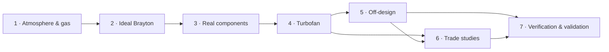

# Propulsion from scratch: the course

Seven lessons build a working gas-turbine performance model from first principles. Each one
derives the theory, turns it into the code in this repository, and checks it against exact
results or published engine data. Each ends with exercises, answers included. The thread through
the course is the move from the CFM56-7B to the LEAP-1B, the engines of the Boeing 737NG and
737 MAX.


## Lessons

| # | Lesson | You will learn | Key result |
|---|---|---|---|
| 1 | [The air an engine breathes](01-atmosphere-and-compressible-flow.md) | the ISA from hydrostatics, flight levels, stagnation properties, the mass-flow parameter, corrected flow | at the same Mach number, cruise and sea-level corrected flows are identical |
| 2 | [The ideal Brayton cycle and the turbojet](02-ideal-brayton-cycle.md) | Brayton efficiency and work, the thrust equation, parametric cycle analysis, thermal vs propulsive efficiency | the optimum pressure ratio falls with Mach number down to the ramjet |
| 3 | [Real components](03-real-components.md) | polytropic efficiency, burner balance with a heating-value datum, nozzles, the loss bill | the gas model matters more than all component losses together |
| 4 | [The turbofan](04-turbofan.md) | two-spool layout, spool balances, why bypass saves fuel, the ideal optima | turbojet → α = 12 cuts TSFC by 45 %; the best fan jet is ~0.8× the core's |
| 5 | [Off-design](05-off-design.md) | choked turbines, matching, continuation, corrected parameters, N1/N2/EGT, validation | ICAO climb-out and approach fuel flows predicted within 1–6 % |
| 6 | [Trade studies](06-trade-studies.md) | best-fan sweeps, carpet plots, the price of bypass, emissions | CFM56-7B → LEAP-1B cycle: −11 % TSFC, mostly from the fan; 3× take-off NOx |
| 7 | [Verification and validation](07-verification-and-validation.md) | test hierarchies, data vs assumption vs calibration, reproducibility | the six mistakes this project caught, and how |



The lessons build on each other in order. Lesson 6 uses the engine models of Lesson 5. Lesson 7
looks back at everything and can be read at any point. The companion note
[From model parameters to EGT, N1, N2 and fuel flow](../flight-parameters.md) connects the course
to engine health monitoring and RUL data.

## Prerequisites

- Thermodynamics: first and second laws, enthalpy, entropy, the perfect-gas law.
- Basic compressible flow: Mach number, stagnation properties (Lesson 1 reviews them).
- Calculus (optimisation by setting a derivative to zero).
- Enough Python/NumPy to read a 50-line function.

## How to use it

1. **Read the lesson.** Every formula is derived. Skip the derivations on a first pass if you like.
2. **Run the matching notebook** in [`notebooks/`](../../notebooks) and change the inputs.
3. **Open the code** linked at the top of each lesson. It is short and mirrors the equations.
4. **Do the exercises** before opening the answers. Every answer was computed with the code.

```bash
uv sync
uv run --with jupyterlab jupyter lab notebooks/
```

JupyterLab is not a project dependency. `--with` pulls it in for that command only.

## Figures

The teaching figures in [`docs/figures/lessons/`](../figures/lessons) are generated by
[`make_figures.py`](make_figures.py). The others are validation figures from
[`validation/`](../../validation).

```bash
uv run python docs/lessons/make_figures.py
```

## Data

The engine comparisons use public data only:
- the ICAO Aircraft Engine Emissions Databank (Issue 32, hosted by EASA);
- the EASA type-certificate data sheets E.004 (CFM56-7B) and E.115 (LEAP-1B).

Each value is cited in [`validation/reference_data/`](../../validation/reference_data).
Everything that is assumed rather than measured is labelled as an assumption.

## Reference texts

- J. D. Mattingly, *Elements of Propulsion: Gas Turbines and Rockets*, 2nd ed. (AIAA, 2006): the
  main companion for Lessons 2–6.
- P. Hill & C. Peterson, *Mechanics and Thermodynamics of Propulsion*: Lessons 1–4.
- H. I. H. Saravanamuttoo et al., *Gas Turbine Theory*: Lessons 3–5.
- P. P. Walsh & P. Fletcher, *Gas Turbine Performance*: Lessons 5 and 7.
- J. D. Anderson, *Modern Compressible Flow*: Lesson 1.
- W. L. Oberkampf & C. J. Roy, *Verification and Validation in Scientific Computing*: Lesson 7.
