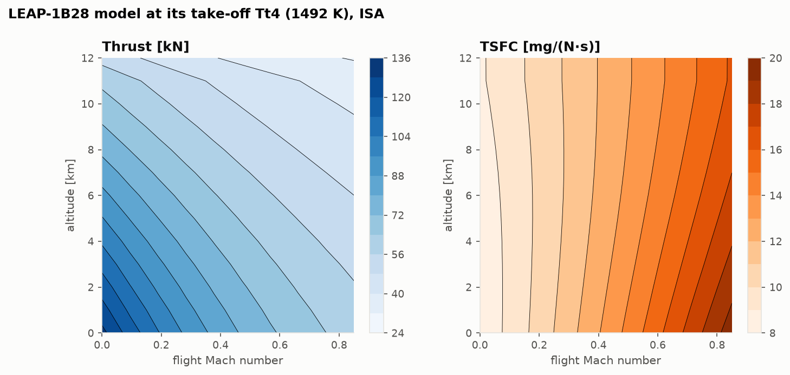

# Validation report

Every module in this repository is checked in one of two ways:
- **verification**: an exact identity, a closed-form result or a published table;
- **validation**: published data for real engines, the CFM56-7B and the LEAP-1B.

The scripts in [`validation/`](../validation) (`uv run python validation/run_all.py`, about 15 s)
produce every number below. They also write the figures in [`docs/figures/`](figures) and the
raw tables in [`validation/results/`](../validation/results). The same checks run as `pytest`
on every push.

As the project plan says, validation against real engines is **trend-level and
order-of-magnitude**. Detailed engine maps are proprietary and are not used.

## Data sources

All public, all cited row by row in [`validation/reference_data/`](../validation/reference_data):

| Source | What is used |
|---|---|
| **ICAO Aircraft Engine Emissions Databank**, Issue 32 (EASA, March 2026) | bypass ratio, overall pressure ratio, rated thrust, LTO fuel flows and NOx indices for the CFM56-7B26/3, -7B27/3, LEAP-1B25 and -1B28 (UIDs 8CM065, 8CM066, 08P28CM146, 08P28CM143) |
| **EASA TCDS E.004**, Issue 07 (CFM56-7B) and **E.115**, Issue 09 (LEAP-1B) | take-off and maximum-continuous ratings, EGT limits and measuring stations, dry weight, length, stage counts |
| **US Standard Atmosphere 1976** / ICAO Doc 7488 | ISA definition and tables |
| Textbooks (Mattingly; Anderson; Saravanamuttoo et al.) | closed forms; the default gas properties and component efficiencies, which are **assumptions** |

## Scorecard

| Module | Check | Result | Reference |
|---|---|---|---|
| Atmosphere | ISA vs US 1976 tables (11, 20, 32 km; 10 km geometric) | ≤ 3.8e-6 | every printed digit |
| Ideal turbojet | η_T identity, 9 cases | 6.7e-16 | exact |
| Ideal turbojet | brute-force optimum πc vs closed form | 4.9e-6 | grid resolution |
| Real turbojet | ideal components reproduce the ideal cycle | 5.6e-16 | exact |
| Turbofan | α = 0 reproduces the turbojet | 0 | exact |
| Turbofan | brute-force α*, πf* vs closed forms | 3.9e-5, 4.3e-6 | grid resolution |
| Off-design | design point reproduced by the matching solver | 0 | exact |
| Off-design | corrected similarity at 3 km vs 9 km | 2.2e-15 | exact (fuel mass off) |
| **CFM56-7B26/3** | ICAO climb-out fuel flow (85 %) | **+1.1 %** | ICAO EEDB |
| **CFM56-7B26/3** | ICAO approach fuel flow (30 %) | **−6.0 %** | ICAO EEDB |
| **CFM56-7B26/3** | ICAO idle fuel flow (7 %) | **−18.8 %** | ICAO EEDB |
| **LEAP-1B28** | ICAO climb-out / approach / idle | **+0.9 / −6.1 / −21.1 %** | ICAO EEDB |
| Trade studies | NOx trend with OPR and model Tt3 | monotonic, 21.8 → 72.7 g/kg | ICAO EEDB |

## 1. Atmosphere and gas dynamics

The ISA built from its definition matches the US 1976 tables to every printed digit, for
example 22,632.06 Pa at 11 km. That required the US 1976 gas constant R*/M0 = 287.0531 J/(kg·K);
ICAO prints 287.05287, which differs by 7×10⁻⁷ and moves the seventh digit. Hydrostatic balance
holds to 10⁻⁶ by finite differences. The isentropic ratios match Anderson's tables, and every
inverse function round-trips.

## 2. Ideal Brayton cycle

There is no data to compare an ideal cycle with, so every check is an identity of the cycle
itself ([`cycle_validation.md`](../validation/results/cycle_validation.md)):
- energy closure;
- turbine work equals compressor work;
- $\eta_O = \eta_T\eta_P$;
- isentropic stations share one entropy;
- the closed-form optimum $\tau_c^{\ast} = \sqrt{\tau_\lambda}/\tau_r$ against a 400,001-point search;
- the zero-thrust and ramjet limits.

## 3. Components and the real turbojet

- With every efficiency set to one, a single gas and the fuel mass neglected, the non-ideal
  turbojet reproduces the ideal one to 6×10⁻¹⁶ at subsonic and supersonic speeds.
- Stacking 20,000 stages of isentropic efficiency e recovers the polytropic relation to 10⁻⁴.
- Entropy rises through every lossy component.
- With losses, TSFC has a minimum at finite pressure ratio. With ideal components it does not.

## 4. Turbofan

- With α = 0 the turbofan *is* the turbojet, exactly, ideal or not.
- The ideal limit matches Mattingly's closed-form jet velocities.
- Brute-force searches over 200,001 points recover the optimum bypass ratio and fan pressure
  ratio, and the jet-velocity conditions that define them ($V_9 - V_0 = \frac12(V_{19} - V_0)$ and
  $V_{19} = V_9$) hold to 10⁻⁹.

## 5. Off-design performance and the real engines

### Verification

- The matching solver reproduces its own design point exactly.
- The LP-turbine nozzle's corrected flow is never imposed, yet stays constant to 10⁻⁸ at every
  operating point. That is the choked-turbine physics checked from the other side.
- Two continuation paths to the same point agree to 10⁻⁹.
- Corrected similarity is exact to round-off.

### Validation against the ICAO databank


Each engine model is built from its ICAO bypass ratio, pressure ratio and rated thrust. It gets
**one calibration**: $T_{t4}$, set so the take-off fuel flow equals the ICAO value. The fan
pressure ratio is the TSFC optimum, and the component quality, booster ratio and nozzles are
declared assumptions shared by both engines
([`engines.py`](../validation/engines.py)). Calibrated $T_{t4}$: 1417 K (CFM56-7B26/3) and
1492 K (LEAP-1B28).

| Mode (thrust) | CFM56-7B26/3 model vs ICAO | LEAP-1B28 model vs ICAO |
|---|---|---|
| take-off (100 %) | calibrated | calibrated |
| climb-out (85 %) | +1.1 % | +0.9 % |
| approach (30 %) | −6.0 % | −6.1 % |
| idle (7 %) | −18.8 % | −21.1 % |

**Discussion.**
- Down to approach the predicted trend is right within 6 %.
- The errors are almost the same for both engines. That marks them as *model* errors, not data
  scatter.
- Near idle the model's assumptions break:
  - real component efficiencies fall far from design incidence (no maps here);
  - the turbine nozzles unchoke;
  - the burner runs lean;
  - the ICAO test includes bleed and power extraction, which the model omits.
  All of these raise real idle fuel flow.

### What the calibration means

The calibrated $T_{t4}$ is an *uncooled-equivalent* turbine temperature. The model has no
turbine cooling flows, so it sits well below a real combustor exit. For the same reason, the
model's LPT-inlet temperatures at take-off (818 °C CFM56, 786 °C LEAP) are far below the TCDS
EGT limits (950 °C at T49.5, 1038 °C at T48). Absolute turbine temperatures from this model are
not validated; their *changes* are used in [flight-parameters](flight-parameters.md).

### Further trends (no direct data; physically expected)


- N1 falls faster than N2 down the throttle line.
- The bypass ratio rises at part power.
- At cruise, TSFC has a bucket around 20–25 kN.
- Thrust lapses roughly with δ0, and the high-bypass LEAP lapses faster.
- An ISA+15 day costs 13 % thrust at the take-off $T_{t4}$, and about +56 K of LPT-inlet
  temperature to restore rated thrust.



## 6. Trade studies

- The fan optimiser reproduces the ideal closed form to 10⁻⁶.
- The diameter proxy inverts the mass-flow parameter exactly.
- The jet-noise index obeys Lighthill's 60 log10 V scaling.
- The classical trends hold: TSFC falls with α and OPR, with diminishing returns; specific
  thrust falls; fans grow.

Two results are tied to data:
- **Weight and length.** The LEAP-1B is 16.5 % heavier and 25 % longer than the CFM56-7B
  (TCDS), the size price of its higher bypass ratio and pressure ratio. Fan diameters are not in
  the TCDS or the databank, so the diameter proxy is not validated.
- **NOx.** Take-off NOx EI rises with pressure ratio across the four ICAO engines (21.8, 23.9,
  48.2, 72.7 g/kg), in step with the model's compressor-exit temperature (808, 820, 899, 920 K).
  This holds even though the LEAP's TAPS II combustor is a low-NOx design.

The model attributes −11.0 % cruise TSFC to the CFM56-7B → LEAP-1B *cycle* change: OPR −2.7 %,
$T_{t4}$ −1.1 %, fan −7.5 %. This holds component technology fixed, so it is not a claim about
the real engines' total improvement.


## 7. What validation caught

Comparing with real data and with exact limits found real errors. All are fixed, tested, and
discussed in the lessons:

1. **Burner datum.** The textbook two-gas burner balance measures each gas's enthalpy from 0 K,
   and over-counts (cpt − cpc)·298 K ≈ 70 kJ/kg of heat. The model then could not match ICAO
   take-off fuel flow at any $T_{t4}$. Enthalpies are now measured from the heating-value datum.
2. **Propulsive efficiency above 1** with convergent nozzles: jet power ignored the
   under-expanded jet's pressure energy. It now uses fully expanded velocities.
3. **Negative TSFC** past the zero-thrust pressure ratio. TSFC is now undefined there.
4. **"Ideal" components still applying supersonic inlet losses**, caught by the exact
   ideal-limit test at Mach 2.
5. **ISA gas constant.** ICAO's printed value missed the US 1976 tables in the seventh digit.
6. **Choked-HPT constraint.** It was imposed as a constant temperature ratio, which is correct
   only at constant efficiency. It is now imposed as the choked-flow condition itself, so worn
   components can be modelled.

## Reproducing everything

```bash
uv sync
uv run pytest
uv run python validation/run_all.py
uv run python notebooks/build_notebooks.py
uv run python docs/lessons/make_figures.py
```

All outputs, including the PNG figures and the executed notebooks, are byte-identical on rebuild.
